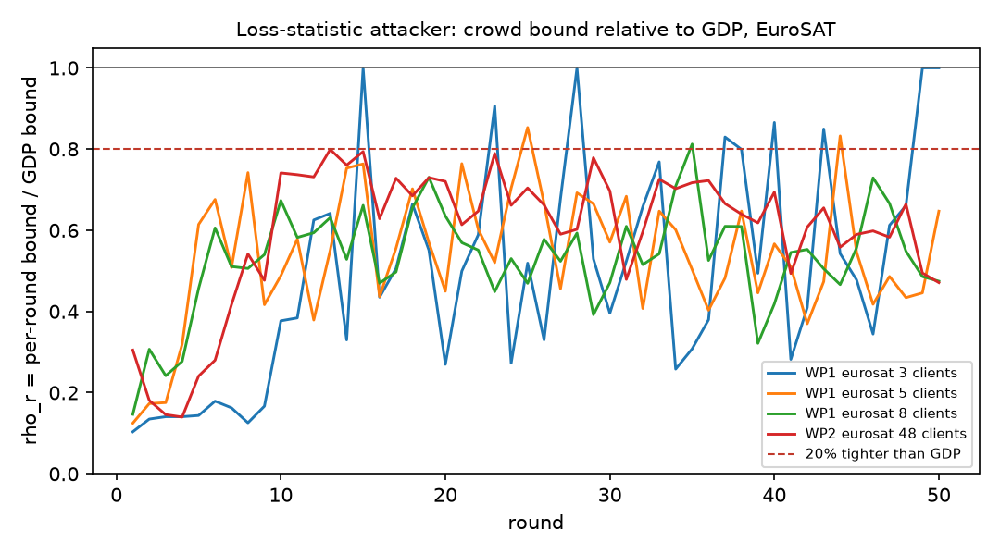
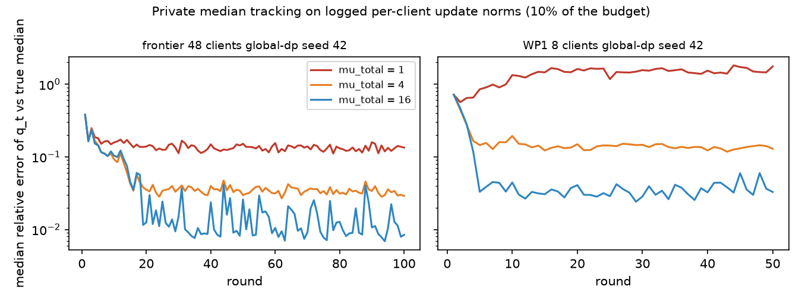

# WP3 findings: client-level partial-knowledge bounds (D3) and private median-distance metric privacy (D4 item 1)

Branch `feature/private-dispersion` (Agent C role). Gate G3: **passed** (both parts; the D3 part with the caveat in
claim 1). Every number below comes from the committed check outputs in `data/` (written by `f_cmip_checks.py` and
`private_dispersion_checks.py` from committed WP1/WP2/frontier logs) or from the tests. Details and proofs:
`f_cmip.md`, `private_dispersion.md`; state and the pre-declared gate rule: `STATE.md`.

## Claim 1: an attacker who does not know the other clients is provably weaker than the GDP bound, but only where that bound is vacuous

For the repository's loss attacker (a one-dimensional statistic per round), the other clients' unknown updates act as
extra noise. The bound for an attacker who knows the target but not the crowd is `rho` times the GDP bound, where
`rho^2` is the share of the loss increment's variance that the DP noise explains (`f_cmip.md`, Propositions 1-2).
Measured on committed runs at the frontier noise (`sigma = 0.00773`), with crowd terms independent across rounds, the
composed ratio is **0.546 at 8 EuroSAT clients and 0.619 at 48 clients**: 45% and 38% tighter, so G3's D3 part passes.
Both bounds are vacuous there, though (composed GDP `mu` 572 and 95 over 50 rounds). The crowd only helps while the DP
noise is small: at 2x and 4x the frontier noise the 48-client ratio is 0.817 and 0.924, and at the noise a
`mu_total = 1` guarantee needs (95-1,525x the frontier noise) the extrapolated ratio is 1.000. Without an assumption on
how the crowd is correlated across rounds, the worst case is the GDP bound itself (Proposition 3).

## Claim 2: metric privacy can be given a formal guarantee and stops leaking through its noise level, but it then cannot beat global DP at the same guarantee

`PrivateMedianMetricPrivacyServerSideFixedClipping` replaces the paper's maximum pairwise distance by a privately
tracked median of each client's distance to the global model: each client contributes one bit and the count gets
Gaussian noise. The noise level is computed only from that private release, with a public floor and a public slot
count. Theorem 1 (`private_dispersion.md`): `T` rounds are `sqrt(T (q_max^2 / z^2 + 1 / sigma_b^2))`-GDP. The default
bit noise gives the median release exactly 10% of the budget (G3's limit). The noise level is a post-processing of
accounted releases, so the WP1 noise-level side channel is closed by construction. The tracker follows the true median
of logged per-client update norms with a median relative error of 12% (48 clients, `mu_total = 1`) and 3.5%
(`mu_total = 4`); with 8 clients it needs `mu_total = 4` (13%; 92% at `mu_total = 1`). The guarantee comes from the
noise floor, which makes the mechanism global DP at that floor plus extra noise whenever the median is below `q_max`.
**At a matched formal guarantee it never uses less noise than global DP.** Any advantage can only be empirical, at
matched measured leakage, as the repository found before for the unrepaired mechanism.

## Further results

- **Participation gap (D1, P2).** To first order the target's loss gap is `w_i eta K <g_i, g_i - g_bar_{-i}>` under
  renormalized aggregation, but `eta K ||g_i||^2 / n` under the fixed public denominator that DP needs: the consensus
  part does not cancel there. Centering on the previous release (residual clipping, WP6) restores the cancellation.
  Toy check: relative error 13.5% to 0.28% (renormalized), 24.5% to 0.79% (fixed denominator) as `eta K` goes from 0.5
  to 0.015 (`data/f_cmip_participation_gap.csv`).
- **Shadow-sample size.** Every `m` is bounded by the crowd bound. In an illustrative alignment model, the attacker's
  GDP-equivalent parameter at 5% FPR rises from 0.67 (`m = 1`) to 1.74 (`m -> inf`) against a crowd bound of 1.77 and a
  GDP value of 2.5 (`data/f_cmip_partial_knowledge.csv`; model parameters assumed, not measured).
- **Checks of the propositions.** Monte Carlo trade-offs match `G_mu` within 0.006 (full release) and 0.0015 (one
  statistic) in type II error (`data/f_cmip_crowd_bound.csv`), and within 0.003 for one round of the private-median
  mechanism (`data/private_dispersion_one_round.csv`).
- **Smoke.** The strategy ran on the real Flower path (3 Alzheimer clients, 3 rounds, CPU, scratch output): noise std
  `z C / (n q_t)`, quantile moving towards the true median, median share 10% (`STATE.md` log).

## Gate G3 and consequences

| Part | Criterion | Result |
|---|---|---|
| D3 | partial-knowledge bound at least 20% tighter than GDP in a runnable regime | 0.546 (EuroSAT 8 clients), 0.619 (48 clients): **pass**, at vacuous noise levels |
| D4.1 | proof complete, tests green, median release at most 10% of the budget | Theorem 1; `uv run pytest` 624 passed, 2 skipped; share 10.0%: **pass** |

Roadmap consequences: D3 becomes a paper section (this note recommends presenting it as an explanation of why
realistic attackers stay far below the GDP bound at practical noise, not as a usable guarantee). D4.1 is the leak-free
metric-privacy baseline, but WP4 will not run (D1 stopped after WP2). WP6 (residual clipping), which depends on WP3, can
start. Proposition 5 gives it a first-order reason under the fixed denominator.

## Limits

Gaussian crowd model with a known population; non-exchangeable (largest) targets not covered; linearized loss
statistic; crowd variance estimated from 4 seeds (15-24 degrees of freedom); the 48-client regime adds noise
analytically to vanilla runs; CIFAR-10 not evaluated (no committed run with increment diagnostics); the D4.1 tracker was
replayed on update norms, a scale-equivalent stand-in for the model distance, not run in a full training.
