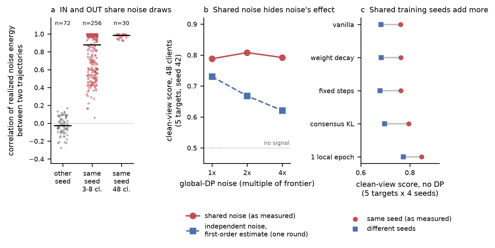

# Review of the 2026-10 CIA programme

Date: 2026-10-16. Scope: everything in the handoff bundle `cia-programme-handoff-2026-10-16` (identical to `master`
at `768bcfa6`): the synthesis, every package's `PROTOCOL.md`, `STATE.md`, `ESCALATION.md` and `FINDINGS.md`, and the
committed trajectories behind them. The new numbers in this file come from
[scripts/measurement_audit.py](scripts/measurement_audit.py), which reads committed result files only (tables in
[tables/](tables/)). No training was run. The new roadmap built on this review is [ROADMAP.md](ROADMAP.md).

## 1. Summary

1. **The agents ran the programme carefully.** Every package fixed its protocol before running and pre-declared its
   gates. Escalations were raised and resolved in writing, negative results were reported as plainly as positive
   ones, and an MPS batch-copy bug that corrupted training on the owner PC was found and fixed. The synthesis quotes
   its sources line by line and is accurate about what each package measured.
2. **Most leakage measurements under DP compared two worlds that drew the same noise.** For one seed, the IN and OUT
   trajectories draw identical server noise vectors (Section 3). The repository's clean-view score and oracle-midpoint
   AUC compare the IN and OUT trajectories of one seed round by round. The DP noise therefore largely cancels out of
   the comparison, so a real attacker, who sees one world, faces noise that these statistics never put in front of it.
   This is the most likely explanation of the synthesis finding that "around the frontier noise, measured leakage
   barely responds to noise" (Section 2.5). A first-order estimate puts the 4x score at 0.621 or lower with
   independent noise, against 0.792 measured. That is a prediction for roadmap package M1, not a measurement.
3. **Even without DP, sharing the training seed between IN and OUT inflates the score.** On WP2's fixed layout, pairing
   IN and OUT across different seeds lowers vanilla's score from 0.762 to 0.682. The ranking of local-training variants
   does not change, so the D1 negative result stands.
4. **WP1's reference federations hold different data from the target.** References for target index `t` are the other
   seeds' trajectories, but the seed also draws the partition, so client `t` holds different data in each reference.
   G1(a)'s pass is probably robust (Section 5); G1(b)'s fail is not evidence against the increment attacker.
5. **No formal client-level guarantee is reachable in this setup at useful accuracy.** At 48 clients and 50 rounds,
   `mu_total = 1` needs 95 times the frontier noise: a noise vector of L2 norm about 396 on an average update whose norm
   is at most 5. "Beating metric privacy" is therefore an empirical claim (lower measured CIA at equal accuracy) unless
   the setup changes to a smaller shared model, more clients, fewer rounds, or a combination.
6. **What stands:**
   - The formal repair of metric privacy, and its result that it never uses less noise than global DP at a matched
     guarantee (WP3).
   - The crowd-bound explanation (WP3).
   - The negative results for D1 (no DP, so the noise coupling does not apply) and for residual clipping as a
     sensitivity reduction (WP6, a mechanism argument).
   - The qualitative noise-level side channel in small federations (WP1).

   **What needs re-measurement:** every leakage-versus-noise statement under DP and every matched-leakage comparison,
   including the earlier "metric privacy behaves like global DP once leakage is matched" where it relied on paired
   trajectories.

## 2. What the programme established

| Package | Gate | Result as reported | Status after this review |
|---|---|---|---|
| WP0 infrastructure | G0 pass | Fixed-noise option, leave-one-out residuals, per-round increments; MPS copy bug fixed | Stands; reused in v2 |
| WP1 noise-level side channel (D2) | G1(a) pass | Blind attack AUC 0.838 [0.779, 0.902] on the largest client, metric privacy, 3-8 clients; global DP 0.763 | Stands qualitatively; magnitude uncertain (mismatched references, Section 5) |
| WP1 increment attacker | G1(b) fail | -0.106 [-0.149, -0.005] vs loss statistic at TPR 5% FPR | Not informative: 2-3 mismatched references per world |
| WP2 local training (D1) | G2 inconclusive, D1 stopped | No variant cut the score by 0.05 within 1 pp; consensus KL lead did not replicate | Stands (no DP; holds on cross-seed pairs too, Section 4) |
| WP3 partial-knowledge bound (D3) | G3 pass | Crowd bound 0.55-0.62x GDP, vacuous noise only | Stands (theory) |
| WP3 formal metric privacy (D4.1) | G3 pass | Proven GDP guarantee, side channel closed, never less noise than GDP at matched guarantee | Stands (theory) |
| WP6 residual clipping (D4.2) | G6 pass as written | Leakage fell through 1.41-1.70x noise, not lower sensitivity | Mechanism conclusion stands; the leakage numbers are paired-noise numbers |
| Consensus-KL follow-up | closed | No replication over 4 seeds; under DP, flat score over 1-4x noise | Seed result stands; DP part needs re-measurement |
| Synthesis 2.5 | n/a | "Measured leakage barely responds to noise" | Probably an artifact of shared noise (Section 3) |

## 3. Finding 1: IN and OUT share their noise draws

**Code path.** `create_initial_model` calls `seed_training(seed)` (`experiments/reproduce/paper_training.py`), which
seeds Python, NumPy and PyTorch. Flower's `add_gaussian_noise_inplace` (used by global DP and metric privacy) draws
from NumPy's global generator, and the private-median and residual-clipping strategies build `np.random.default_rng(seed)`.
The IN and OUT trajectories of a seed therefore run the same server-side random sequence. The WP0 test
`tests/test_fixed_noise_stdv.py` verifies exactly this property ("bit-identical noise IN and OUT from the same RNG
state") as a feature of the fixed-noise option. It is the right property for checking that the noise *level* is the
same, and the wrong one for measuring leakage.

**Evidence from committed logs.** Per round, `||Delta||^2 - ||s||^2 - E||xi||^2` isolates the realized noise energy.
Here `Delta` is the released update norm (`releases.json`), `s` the clipped signal norm and `E||xi||` the expected
noise norm (both in the training JSON). Its correlation between two trajectories is near 1 if they share noise
vectors and near 0 if not ([tables/noise_coupling_correlations.csv](tables/noise_coupling_correlations.csv)):

| Pair of trajectories | n pairs | Mean | Median | Range |
|---|---|---|---|---|
| Different seeds, IN vs IN (WP1, 3-8 clients) | 72 | -0.024 | -0.026 | -0.277 to 0.167 |
| Same seed, IN vs OUT (WP1, 3-8 clients) | 256 | 0.777 | 0.880 | 0.063 to 0.999 |
| Same seed, IN vs OUT (consensus-KL step 3, 48 clients, 1-4x noise) | 30 | 0.975 | 0.984 | 0.925 to 0.997 |

The small-federation correlations are lower, probably because the signal term `2<s, xi>` differs more between the worlds there (the target is a third to an eighth of the federation).

**Consequence.** The clean-view score and the oracle-midpoint AUC (the AUC uses `m = (L_IN + L_OUT)/2`, so it is a
function of the paired gap `g = L_OUT - L_IN` alone) compare two trajectories that received the same noise. The noise
enters `g` only through second-order effects. A real attacker observes one world and must separate it from the other
world's *distribution*, which includes independent noise.

**How large is the effect?** One round of independent noise moves the shadow loss by about `<grad L, xi>`, with
standard deviation `sigma ||grad L||`. The shadow-gradient norm is logged as `clean_grad_norm_start`. Adding this to
both worlds gives a first-order estimate of the decoupled score. Under linearization it is an upper bound: independent
noise from earlier rounds adds variance, which pushes each round's `P(g + e > 0)` further towards 0.5. The bound is
not measured; M1 tests it ([tables/decoupled_score_bound.csv](tables/decoupled_score_bound.csv), global DP, 48 clients, seed 42,
five targets):

| Noise (x frontier) | Paired score as measured | Decoupled, one-round upper bound | Median gap `g` | Median one-round noise sd |
|---|---|---|---|---|
| 1 | 0.788 | 0.730 | 0.046 | 0.051 |
| 2 | 0.808 | 0.668 | 0.050 | 0.098 |
| 4 | 0.792 | 0.621 | 0.060 | 0.213 |

**Results whose DP leakage numbers are paired-noise numbers.** This is a statement about the design (same code path); how
much the coupling matters was estimated only for global DP at 48 clients and 1-4x noise, and the pre-WP0 runs log no
realized update norm, so their coupling is inferred from the code:

- The EuroSAT frontier (September).
- The AUC-targeted noise sweep.
- The 3-client plan suite.
- WP6.
- Consensus-KL step 3.
- Any matched-leakage comparison built on these runs.

The stacked-head comparison used its own pipeline and was not checked here. WP1 is not affected: its attacks compare
each trajectory with references from other seeds.

## 4. Finding 2: shared training randomness inflates paired scores without DP

WP2 seeds 42-45 share one partition layout ("seed-42 layout", Amendment 1), so IN of seed `a` can be compared with OUT
of seed `b != a`. This keeps the data fixed and makes the training randomness (initialization, client batches, dropout)
independent between the worlds ([tables/cross_seed_scores_wp2.csv](tables/cross_seed_scores_wp2.csv); 5 targets, 16 IN-OUT
seed pairs per target):

| Configuration | Same seed (as measured) | Different seeds |
|---|---|---|
| Vanilla | 0.762 | 0.682 |
| Weight decay 5e-4 | 0.763 | 0.683 |
| Fixed local steps | 0.763 | 0.678 |
| Consensus KL 0.3 | 0.795 | 0.697 |
| One local epoch | 0.848 | 0.774 |

Leakage without DP is real (0.68 with independent training randomness), and the variants rank as before, so the D1
conclusion is unchanged. The paired design adds about 0.08 to the score; the realistic attacker does not get this
help.

## 5. Finding 3: WP1's references are federations with different data

WP1 draws the partition from the seed ("one seed controls partition and training") and builds references for target
index `t` from the other seeds' IN and OUT-`t` trajectories. Client `t` holds different data in each of those
trajectories. In the 3-client EuroSAT cell, for example, client 1 holds 9,573 records at seed 42, 6,779 at seed 43 and
7,890 at seed 44; the largest client is index 1, 2, 2 and 1 at seeds 42-45. The loss and increment attackers therefore
compare the target's shadow loss with reference losses on other clients' shadow samples. Two to three such references
per world explain the instability that WP1 reports for low-FPR rates.

- **Effect on G1(a).** The noise-level attack reads the server's noise std. The oracle with the true std (0.839) matches
  the blind attack (0.838) and is 0.500 under global DP by construction. The separation is therefore driven by how
  metric privacy's std depends on who participates, and mismatched references more likely blur it than create it.
  The claim stands qualitatively; its size should be re-measured with matched references (roadmap A2).
- **Effect on G1(b).** The fail does not show that a likelihood-ratio attacker with correct references is weaker than
  the loss statistic.

The noise-level channel is stronger than WP1 could show in one respect. The noise std is estimable from one release to
about `1/sqrt(2D)` relative precision (0.13% for EuroSAT, 0.03% for the 6.5 M-parameter Alzheimer CNN) *whatever
the noise magnitude*. At noise large enough to silence the loss attacker, metric privacy would still announce `d_t`
every round. This is testable cheaply in small federations (roadmap A2).

## 6. Finding 4: the formal regime is out of reach at this scale

With equal weights and a public slot count, one round of global DP at noise ratio `r` is `1/(n r)`-GDP. At the frontier
(`r = 0.001546`, `n = 48`) that is 13.5 per round and 95.3 over 50 rounds (WP6). A total of `mu = 1` over 50 rounds
needs `r = 1/(48 x 0.1414) = 0.147`, a per-coordinate std of 0.74 on the average update. Over 289,194 parameters that is
a noise vector of norm about 396 against a clipped signal of norm at most 5. WP3 puts the requirement at 95-1,525 times
the frontier noise across the committed settings. Client-level DP with useful accuracy needs one or more of the
following:

- Many more clients.
- Fewer rounds.
- Client subsampling, which amplifies only when the per-round `mu` is already near 1.
- A much smaller shared object, for example a linear head on frozen public features.

Two consequences:

- In the current setup any claim against metric privacy is empirical: lower measured CIA at equal accuracy, under a
  measurement that does not cancel the noise.
- A formal claim needs a different regime. The closed client-specific-noise line already met the obstacle there:
  public-only models are strong when public data are plentiful.

## 7. The synthesis's candidate directions, re-assessed

| # | Synthesis proposal | Assessment | Placement in ROADMAP.md |
|---|---|---|---|
| P1 | Leakage-accuracy curve at much higher noise | Right question, but must be measured with independent noise; the 1-4x flatness it starts from is probably the artifact | M2 (core) |
| P2 | Client subsampling | Standard deployment, formally sound; its empirical effect (the target is absent from most rounds) is untested | B1 |
| P3 | Why the largest clients leak everywhere | Exposure tracks size (Spearman 0.58-0.59 earlier; label skew alone does not predict it: Spearman 0.02 and 0.24 on the frontier targets) | B5 |
| P4 | Side channels in other adaptive DP rules | Adaptive clipping with a private quantile is accounted by construction; low priority | Not scheduled |
| P5 | Public-validation step-size gate | Post-processing, keeps the guarantee, cheap | B3 |
| P6 | Stronger reference attacker | Subsumed by the v2 measurement standard (matched references, many replicates) | M0, M2 |
| D5 | Temporal allocation (on hold) | Its demotion relied on the flat noise response; reopen once M2 shows how leakage responds to noise | B2 |
| D6 | Low-dimensional sharing (on hold) | Becomes part of the formal-regime study | B4 |

## 8. Implications for the research question

The question "can a technique protect better than metric privacy against CIA?" has three honest forms, in increasing
order of difficulty:

1. **Audit form.** Is metric privacy's apparent advantage real? Evidence so far: no at a matched guarantee (proof) and
   no at matched paired leakage (to be re-measured). In small federations it adds a participation side channel.
2. **Empirical form.** Is there a mechanism with a formal guarantee no weaker than global DP's that has lower measured
   CIA than metric privacy at equal accuracy, under an attacker-realistic measurement? Candidates: subsampling, a
   leakage-aware schedule, the public-validation gate, contribution caps for large clients, and their combination.
3. **Formal form.** Is there a regime where a non-vacuous client-level guarantee and useful accuracy coexist, and does a
   mechanism beat global DP or metric privacy there? This needs the setup change described in Section 6.

All three need the measurement fixed first. ROADMAP.md orders the work that way.
