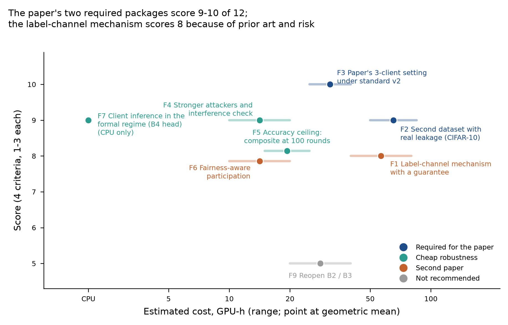

# Future directions after roadmap v2, ranked

Written 2026-10-30 on branch `docs/cia-roadmap-v3`, from `HANDOFF_AUDIT.md`, `NOVELTY_CHECK.md`,
`reanalysis/FINDINGS.md` and `PAPER_OPTIONS.md`. Scores and costs: `tables/direction_scores.csv`.

**In plain words.**
1. The next round should mostly finish the paper. Two packages are required: the published paper's own small setting
   and a second dataset where clients actually leak. Three cheap checks would make its positive result hard to attack.
2. A genuinely new defense, one that hides each client's label mix with a guarantee, is the natural second paper. It
   now has published competitors (LDPM, RR-Label), so it should start with a small, gated screen rather than a full
   programme.

*Score: four criteria, 1-3 each:*
- *goal fit (beats metric privacy against client inference, or is needed for the paper);*
- *novelty (from `NOVELTY_CHECK.md`);*
- *feasibility with the existing runner;*
- *low risk of an uninformative result.*

*Cost: from v2's measured 0.1 GPU-h per EuroSAT randomized-inclusion run. F5 and F6 both score 8 and are drawn 0.14
apart for legibility.*

**Excluded on project evidence:** further noise-shape or calibration rules, which the client-specific-noise direction
(closed 2026-10-09) and A-3 both rule out.

## Required for the paper

### F3. The paper's own 3-client setting under standard v2 (score 10; 25-40 GPU-h)

**Experiment.**
- 3-client Alzheimer federations as in the paper (the plan-suite Alzheimer modules), with vanilla, global DP and
  metric privacy at the paper's noise.
- 20 independent IN/OUT pairs per mechanism, each world with its own `noise_seed` and `client_seed`.
- Two statistics on the same runs:
  1. the paper's own pooled-checkpoint ROC per pair, giving its sampling distribution;
  2. the calibrated attacker across the 40 trajectories per mechanism (leave-one-pair-out references).

**Hypothesis.**
- The paper's statistic varies widely across pairs, so Table 13's 0.397 and 0.493 are single draws.
- A calibrated attacker separates IN from OUT above chance under both DP mechanisms at the paper's noise.

**First decisive test:** a 4-run cost pilot, then the full design.
- Gate, on the global-DP and metric-privacy cells: the calibrated attacker's AUC has a 95% lower bound above 0.5.
- If not, the audit says the paper's own small-sample claim is consistent with its setting, and only A-3 carries the
  audit.

### F2. A second dataset with real leakage (score 9; 50-85 GPU-h)

**Experiment.**
- CIFAR-10, label-Dirichlet 0.3, 48 slots, M2's randomized-inclusion design.
- 10 configurations: vanilla, 3 global-DP levels, 3 metric-privacy levels, 3 composite levels.
- New code: a label-Dirichlet CIFAR-10 module for the runner (`experiments/reproduce/dataset/cifar10.py` has the
  data).

**Hypothesis.** A-3 (equivalence) and D-4 (composite wins) replicate.

**First decisive test:** vanilla leakage on 8 replicates.
- **Gate:** all-candidate AUC at least 0.65. Below that, stop, as Alzheimer showed a non-leaking dataset cannot
  discriminate.
- **Then:** G-A1 and G-C1 exactly as on EuroSAT.

## Cheap robustness for the paper

### F4. Stronger attackers and the interference check (score 9; 10-20 GPU-h)

**Experiment.**
1. Re-run 2 composite levels and 2 metric-privacy levels with shadow losses logged at all 51 rounds. Score an
   every-round sampling-aware attacker.
2. One global-DP level with 8 and 24 candidates IN per replicate instead of 16, to test whether one-run interference
   (Keinan et al. 2025) weakens the attacker.

**Hypothesis.** The composite's gain stays at least 0.05 under the every-round attacker. AUC does not depend on the
IN count beyond ±0.03.

**First decisive test.**
- The every-round attacker on the composite at the 0.740 level against metric privacy, with the G-C1 rule.
- If the IN count changes AUC by more than 0.03, v3's measurement standard adds an IN-count correction before any
  further gate.

### F7. Client inference in the formal regime (score 9; CPU only)

**Experiment.**
- On B4's frozen-feature linear head, where `mu <= 2` is reachable, run randomized-inclusion client inference
  against:
  - the DP head (global DP);
  - metric privacy's calibration applied to the head;
  - subsampled DP.
- CPU only; B4's confirmation took 0.675 CPU-hours for 480 runs.

**Hypothesis.** With a non-vacuous guarantee, global DP and subsampled DP both keep AUC near 0.5, while metric
privacy's distance calibration gives no extra protection.

**First decisive test:** global DP at `mu = 2` on the head. The attacker's AUC upper bound at or below 0.60 confirms
that the regime is protective. That gives the paper one setting where "beats metric privacy" comes with a real
guarantee.

### F5. The accuracy ceiling (score 8; 15-25 GPU-h)

**Experiment.** The composite at 100 rounds, 3 noise levels, to lift the reachable accuracy from 0.772 towards
vanilla's 0.803.

**Hypothesis.** The composite reaches at least 0.78 with AUC still at least 0.05 below metric privacy at the matched
accuracy. Metric privacy's 100-round curve would be needed for the match: 3 more configurations, included in the cost.

**First decisive test.** An accuracy pilot (2 runs per level). If it cannot reach 0.78, report the ceiling as a
limitation and stop.

## Second paper

### F1. A label-channel mechanism with a guarantee (score 8; 40-80 GPU-h for a screen and a frontier)

**Idea.**
- Leakage on label-skewed data is mostly label-mix inference (D-1).
- Instead of diluting participation, privatize the label channel itself with a guarantee on the client's label
  distribution:
  - LDPM's notion, (m, gamma, xi)-label distributional privacy, which is stated for one-vs-all models;
  - a client-level DP release of the label prior that the local objective uses in place of the client's own prior.
- Combine it with full participation, to avoid subsampling's accuracy ceiling.

**Prior art to beat:**
- LDPM (Jiang et al., S&P 2024; full text needs institutional access);
- RR-Label (Zheng and Li, TDSC 2023).

**Hypothesis.** At full participation, a label-private local objective reaches the composite's AUC (about 0.60) at
accuracy of at least 0.74, which subsampling cannot reach without its ceiling.

**First decisive test.**
- Design: a design memo, then RR-Label and one label-prior variant at 2 noise levels on EuroSAT.
- Gate: at least 0.05 below metric privacy at 0.740, and no worse than the composite by more than 0.03.
- Cost: about 12 GPU-h.
- If it fails, the second paper does not start.

### F6. Fairness-aware participation (score 8; 10-20 GPU-h)

**Experiment.** Participation schemes that keep subsampling's gain but stop losing rare-label clients:
- stratified sampling by label-mix cluster;
- a guaranteed minimum participation.

Their formal accounting differs from Poisson sampling (Lebeda et al. 2025), so it is reported, as in B1.

**Hypothesis.** Lowest-client accuracy within 2 pp of metric privacy at matched accuracy, AUC still at least 0.05
lower.

**First decisive test.** One scheme at the composite's 0.740 level, under both the standard and the sampling-aware
attacker.

## Not recommended

### F9. Reopening B2 (temporal allocation) or B3 (public-validation gate) (score 5; 20-40 GPU-h)

- B2 rests on leakage responding to noise, and M2 found it barely does.
- B3 is on hold by owner decision, and nothing in v2 changes that.

## Order

1. **F3 and F7 first.** They are cheap, independent, and run on the owner PC or a single server GPU.
2. **F2 after its vanilla-leakage gate.**
3. **F4 next to F2,** on the second GPU.
4. **F5 if the owner wants the accuracy ceiling in the paper.**
5. **F1's screen only after the paper's packages close, or in parallel if a third agent is available.**

`ROADMAP.md` turns this order into packages, gates and caps.
