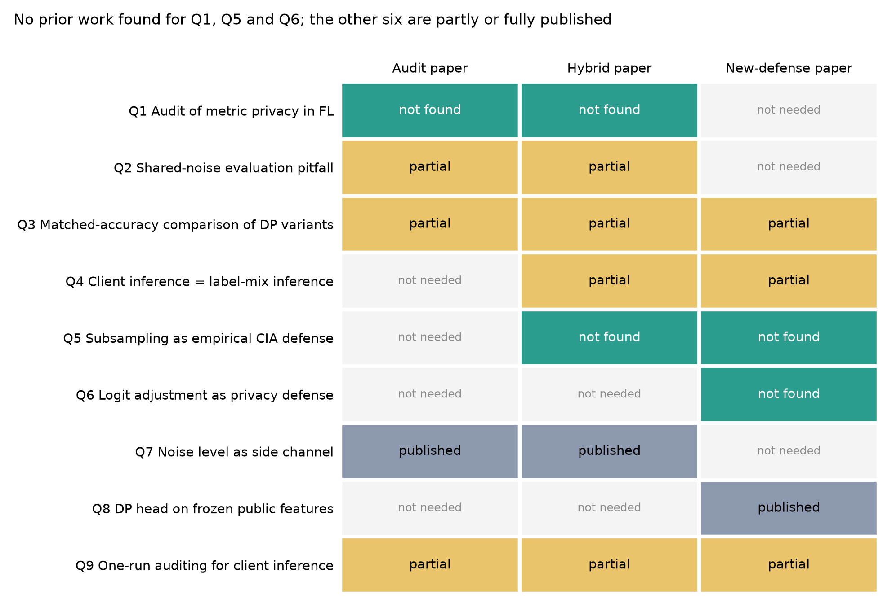

# Literature and novelty check for the CIA roadmap v2 results

Written 2026-10-30 on branch `docs/cia-roadmap-v3`, answering the nine questions of
`research/cia_roadmap_v2/RESULTS_HANDOFF.md` Section 6. The evidence table is `tables/novelty_evidence.csv` (55
rows), the BibTeX is `references_v3.bib` and the figure is `figures/novelty_matrix.png`.

**In plain words.**
1. Nobody has audited the metric-privacy defense, and nobody has measured client subsampling as a defense against
   client inference at matched accuracy. Those two findings are new. Most of the rest applies known principles to a new
   case.
2. The "genuinely new defense" the handoff sketches, a private label-distribution release, is already partly
   published: a formal label-distribution privacy mechanism exists for cross-silo FL, and a label-randomization defense
   exists for client-targeted membership inference. Any new mechanism has to beat those, not only metric privacy.

## Verdicts

| # | Question | Verdict | Closest prior work and the difference |
|---|---|---|---|
| Q1 | Has metric privacy in FL been audited? | **Not found** | No citing work for either version of the paper. Metric-DP and Gaussian mechanisms have been compared empirically for DP-SGD ([Faustini 2022](https://doi.org/10.48550/arxiv.2211.04686); [Faustini 2025](https://doi.org/10.1109/access.2025.3633551)), not for distance-calibrated server noise or client inference. |
| Q2 | Is the shared-noise (coupled-worlds) pitfall documented? | **Partial** | Evaluation pitfalls are documented ([Aerni 2024](https://doi.org/10.1145/3658644.3690194); [Jälkö 2026](https://doi.org/10.48550/arxiv.2605.25819)), and membership games are known to differ by fixed or fresh seeds ([Kong 2023](https://doi.org/10.48550/arxiv.2303.03648)). The effect found here, that coupling makes DP leakage insensitive to noise, was not found. |
| Q3 | Matched-accuracy comparisons; "better-utility" DP variants as noise rescaling? | **Partial** | The principle is published: tighter-accounting variants leak more at the same nominal budget ([Jayaraman 2019](https://doi.org/10.48550/arxiv.1902.08874)), and defenses should be compared with a tuned DP baseline at matched utility ([Aerni 2024](https://doi.org/10.1145/3658644.3690194); [Liu 2021](https://doi.org/10.48550/arxiv.2110.05524)). Applying it to metric privacy in FL is new. |
| Q4 | Is client inference on label-skewed FL mostly label-distribution inference? | **Partial** | Label-distribution and category inference are established ([Gao 2021](https://doi.org/10.1109/tdsc.2021.3128679); [Gu 2023](https://doi.org/10.1016/j.jisa.2023.103475); [Ma 2025](https://doi.org/10.48550/arxiv.2504.21436)). Client-targeted membership inference is known to defeat DP-SGD under label skew ([Zheng 2023](https://doi.org/10.1109/tdsc.2023.3346692)), and subject-level attacks work from distribution knowledge alone ([Suri 2022](https://doi.org/10.48550/arxiv.2206.03317)). Not found: the quantitative decomposition that a label-mix-only attacker reaches the shadow-sample attacker's AUC within 0.009-0.025. |
| Q5 | Has client subsampling been evaluated empirically against client inference at matched accuracy? | **Not found** | Amplification is formal ([Balle 2018](https://doi.org/10.48550/arxiv.1807.01647); [McMahan 2017](https://doi.org/10.48550/arxiv.1710.06963); [Seif 2021](https://doi.org/10.1109/jsac.2021.3118408)). Empirical privacy of sampled DP-FedAvg has been estimated with canary clients ([Andrew 2023](https://doi.org/10.48550/arxiv.2302.03098)), but not as attack AUC on real clients against other mechanisms at matched accuracy. |
| Q6 | Has logit adjustment been studied as a privacy defense? | **Not found** | Logit adjustment is an accuracy method ([Menon 2020](https://doi.org/10.48550/arxiv.2007.07314); [Zhang 2022](https://doi.org/10.48550/arxiv.2209.00189)). Long-tail methods do not remove tail-class membership risk ([Hu 2025](https://doi.org/10.1109/tifs.2025.3607261)). The project's own result is that it adds no privacy at matched accuracy, so there is nothing positive to claim. |
| Q7 | Data-dependent noise levels as side channels? | **Published (principle)** | That instance-based noise magnitudes must not leak the data is foundational ([Nissim 2007](https://doi.org/10.1145/1250790.1250803)), and data-dependent scales in DP-FL are privatized for this reason ([Andrew 2019](https://doi.org/10.48550/arxiv.1905.03871)). The measured attack on metric privacy in small federations is a new instance. |
| Q8 | DP heads on frozen public features with scarce public data? | **Published** | DP linear models on public features ([Tramèr 2020](https://doi.org/10.48550/arxiv.2011.11660)), few-shot DP including head-only training and DP FL ([Tobaben 2023](https://doi.org/10.48550/arxiv.2302.01190)), and semi-private learning with scarce public data ([Pinto 2024](https://doi.org/10.1109/satml59370.2024.00014)). B4's positive is a confirmation of known behaviour. |
| Q9 | One-run / randomized-inclusion auditing for client inference in FL? | **Partial** | One-run auditing ([Steinke 2023](https://doi.org/10.48550/arxiv.2305.08846); [Mahloujifar 2024](https://doi.org/10.48550/arxiv.2410.22235)) and one-shot FL estimation with canary clients ([Andrew 2023](https://doi.org/10.48550/arxiv.2302.03098); [Maddock 2022](https://doi.org/10.48550/arxiv.2210.02912)) are published. Using real clients as randomly included candidates with a calibrated attacker to compare mechanisms at matched accuracy was not found. |

## The audit questions

### Metric privacy has no published audit

No paper found evaluates the Sáinz-Pardo Díaz et al. mechanism, and OpenAlex lists no work citing either version
([Sáinz-Pardo Díaz et al. 2026](https://doi.org/10.1016/j.knosys.2026.115993); [Sáinz-Pardo Díaz et al. 2025](https://doi.org/10.48550/arxiv.2502.01352)). The two versions frame the
mechanism differently, which matters for the audit's wording. The arXiv version presents metric privacy as a relaxation
of DP, while the journal abstract says it does not enforce metric privacy as a formal guarantee and uses it only to
guide calibration. The journal version therefore makes no formal claim for A-5 to refute; its claims are empirical,
better accuracy and a CIA success rate comparable to global DP. The audit should lead with A-3 (matched accuracy) and
treat A-5 as context. The nearest precedent is the empirical-calibration line of [Faustini 2022](https://doi.org/10.48550/arxiv.2211.04686) and
[Faustini 2025](https://doi.org/10.1109/access.2025.3633551). It argues that metric-DP and Gaussian parameters are not comparable and compares them
through attacks, which is the same move as the matched-accuracy statistic of A-3 (package A1), applied to DP-SGD rather than to
server noise.

### Coupled randomness is a known game choice, not a known pitfall

The membership-inference literature distinguishes games with fixed or fresh dataset and training seeds
([Kong 2023](https://doi.org/10.48550/arxiv.2303.03648)), and one attack on aggregate data deliberately injects the same noise into paired
IN and OUT aggregates when training its classifier ([Guan 2024](https://doi.org/10.56553/popets-2024-0108)). Pitfall papers catalogue
average-case reporting, weak attacks, missing DP baselines ([Aerni 2024](https://doi.org/10.1145/3658644.3690194)) and biased shadow-set
sampling ([Jälkö 2026](https://doi.org/10.48550/arxiv.2605.25819)). None of them reports what M1 measured: sharing the DP noise and client
seeds between the two worlds makes a paired leakage score flat in the noise level (0.79 at 1-4x, against 0.516 once
decoupled). Following handoff correction C3, this is a lesson about this project's own earlier measurement. It is
worth a short section or a methods note, not a headline about the paper.

### Matched-accuracy comparison is the accepted standard

The idea that a DP variant which seems to give better utility may simply add less noise is old:
[Jayaraman 2019](https://doi.org/10.48550/arxiv.1902.08874) showed that variants with tighter accounting appear to need a smaller budget and leak
correspondingly more. The recommendation to compare at matched utility against a tuned DP baseline is now standard
([Aerni 2024](https://doi.org/10.1145/3658644.3690194)). [Liu 2021](https://doi.org/10.48550/arxiv.2110.05524) applied it to show that early stopping and other
generalization techniques can beat DP against membership inference at equal utility. A-3 applies this standard to a
published FL mechanism and finds equivalence within ±0.03 at 0.740 accuracy (no detectable difference at
0.660). That is a new result, but the framing should credit these
sources rather than present matched accuracy as a contribution.

### The noise-level side channel is a known principle

That an instance-dependent noise magnitude can leak the data was named when instance-based noise was introduced
([Nissim 2007](https://doi.org/10.1145/1250790.1250803)). Adaptive clipping in DP-FedAvg privatizes its data-dependent scale for this reason
([Andrew 2019](https://doi.org/10.48550/arxiv.1905.03871)), and data-dependent hyperparameters and per-instance losses are known to leak
([Papernot 2021](https://doi.org/10.48550/arxiv.2110.03620); [Redberg 2021](https://doi.org/10.48550/arxiv.2111.02281)). A-4's contribution is to show that metric privacy's
calibration violates the principle measurably in 3-8-client federations (blind AUC 0.838) and that the effect fades by
48 clients. That is a supporting finding, consistent with the handoff's "real but secondary".

## The defense questions

### Label-distribution inference and label-channel defenses exist

The defense paper's explanatory claim, that client inference on label-skewed data is mostly inference of the label
mix, sits inside an established literature. Category and label-distribution inference against FL clients is well
studied ([Gao 2021](https://doi.org/10.1109/tdsc.2021.3128679); [Gu 2023](https://doi.org/10.1016/j.jisa.2023.103475); [Ma 2025](https://doi.org/10.48550/arxiv.2504.21436);
[Kerkouche 2023](https://doi.org/10.1145/3603216.3624964)). Subject-level membership attacks succeed from distribution knowledge without records
([Suri 2022](https://doi.org/10.48550/arxiv.2206.03317)). Most directly, [Zheng 2023](https://doi.org/10.1109/tdsc.2023.3346692) report that DP-SGD protects
client-targeted membership under IID data but not under label-biased non-IID data, and propose a label
randomized-response defense. A formal mechanism for label-distribution privacy in cross-silo FL also exists
([Jiang 2024](https://doi.org/10.1109/sp54263.2024.00113)). It is stated for one-vs-all classifiers and also satisfies DP. Two consequences
follow. D-1's decomposition (a label-mix-only attacker is within 0.009-0.025 AUC of the shadow-sample attacker) is a
sharper quantitative version of a known effect. And the handoff's "genuinely new defense" (a privatized label-prior
release) must be positioned against these two mechanisms and should include at least one of them as a baseline.

### Subsampling as a client-inference defense has not been measured

Amplification by sampling is textbook ([Balle 2018](https://doi.org/10.48550/arxiv.1807.01647); [McMahan 2017](https://doi.org/10.48550/arxiv.1710.06963)), and recent
FL papers vary per-client sampling rates for formal reasons ([Lange 2025](https://doi.org/10.1109/icmlt65785.2025.11193238);
[Xu 2026](https://doi.org/10.1109/jiot.2026.3661913)). Empirical work on sampled DP-FedAvg estimates epsilon with canary clients
([Andrew 2023](https://doi.org/10.48550/arxiv.2302.03098)). No study found measures attack AUC on real clients at matched accuracy against
full-participation mechanisms, which is what B1 and C1 did. Two published cautions bear on that result. The guarantee
depends on the sampling scheme actually implemented and accounted for ([Chua 2024](https://doi.org/10.48550/arxiv.2403.17673);
[Lebeda 2025](https://doi.org/10.1109/satml64287.2025.00060)). And amplification assumes the sample is secret, which is the open issue I1 that
the re-analysis tests. Early stopping is a known empirical defense ([Liu 2021](https://doi.org/10.48550/arxiv.2110.05524)), so the
"fewer contributions" control (issue I2) is needed before the subsampling result can be called specific to sampling.

### Logit adjustment has no privacy literature, and no privacy effect to report

Logit adjustment and its FL form are accuracy methods ([Menon 2020](https://doi.org/10.48550/arxiv.2007.07314); [Zhang 2022](https://doi.org/10.48550/arxiv.2209.00189)).
The nearest privacy work studies long-tail methods and finds that tail classes stay exposed
([Hu 2025](https://doi.org/10.1109/tifs.2025.3607261)). Since C1 found no privacy gain at matched accuracy, the literature gap gives no
claim to make. The honest use of D-2 is as a utility component, together with B5's same-noise result, in a defense
section.

### The formal regime confirms known behaviour

B4's finding that a DP linear head on frozen public features beats public-only heads when public data are scarce is
what [Tramèr 2020](https://doi.org/10.48550/arxiv.2011.11660), [Tobaben 2023](https://doi.org/10.48550/arxiv.2302.01190) and [Pinto 2024](https://doi.org/10.1109/satml59370.2024.00014) lead one
to expect. It is useful as a sanity check and as the only non-vacuous regime, not as a contribution.

## The method question

One-run and randomized-inclusion auditing are published, including FL variants that insert random canary clients
([Steinke 2023](https://doi.org/10.48550/arxiv.2305.08846); [Andrew 2023](https://doi.org/10.48550/arxiv.2302.03098); [Maddock 2022](https://doi.org/10.48550/arxiv.2210.02912);
[Mahloujifar 2024](https://doi.org/10.48550/arxiv.2410.22235); [Xiang 2025](https://doi.org/10.48550/arxiv.2509.08704)). Standard v2 differs in three ways: real clients
are the candidates, the attacker is calibrated per candidate, and the design compares mechanisms at matched accuracy.
The design should be credited to these sources. One published result is a threat to validity:
[Keinan 2025](https://doi.org/10.52202/085713-1632) show that the power of one-run designs is limited by interference between included elements,
and [Dagréou 2026](https://doi.org/10.48550/arxiv.2605.27292) report the same for canaries. With 16 candidates IN per run, interference between
candidates could weaken the attacker in some mechanisms more than in others. A v3 package should check this, for example
by comparing AUC between replicates with 8 and 24 candidates IN.

## What this changes

- **Audit paper.** Its central claim (Q1) is new, and its framing (Q3) follows the accepted standard, which makes it
  easy to defend in review. The shared-noise finding (Q2) and the side channel (Q7) are supporting results. It still
  lacks a test of the paper's own setting (handoff issue I5) and a second dataset with real leakage (I4).
- **New-defense paper.** The empirical subsampling result (Q5) is new, but its mechanism is standard and the label-channel
  explanation (Q4) is partly known. The label-channel mechanism the handoff calls "genuinely new" must now be compared
  with LDPM and RR-Label ([Jiang 2024](https://doi.org/10.1109/sp54263.2024.00113); [Zheng 2023](https://doi.org/10.1109/tdsc.2023.3346692)).
- **Hybrid.** It uses both new results (Q1, Q5) and needs only cheap additions: the re-analyses in
  `reanalysis/`, and a small run of the paper's 3-client setting.

## Search record

- **OpenAlex** (stored key), title-and-abstract search ranked by relevance:
  - 54 queries, 6 per question: 388 hits, 364 unique works.
  - A first pass ranked by citation count returned mostly off-topic works and was discarded.
- **Forward citations** of ten anchors: the audited paper (both versions), Aerni 2024, Wainakh 2022, Andrew 2023,
  Tramèr 2020, Debenedetti 2023, Steinke 2023, CMI 2023 and LDIA 2023.
- **Targeted lookups** of expected candidates: 41 title searches, 8 CrossRef citation lookups and 8 arXiv DOI
  lookups.
- **Web search:** 3 queries on Q1, Q2 and Q5.
- **Verification:** every DOI in the evidence table resolves (CrossRef or doi.org), and none is flagged as retracted.
- **Full text:** LDPM's is closed-access, so its description rests on the abstract.
- **Coverage limit:** 2026 preprints and venues are only partly indexed, so "not found" means not found in these
  sources on 2026-10-30.
