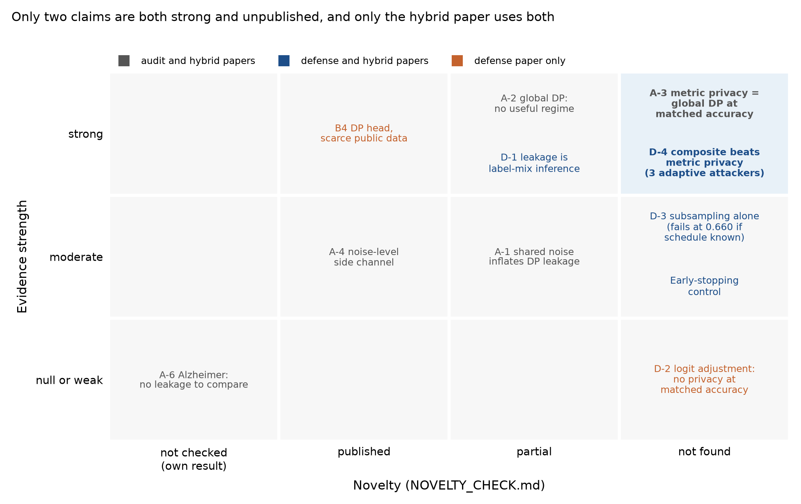

# Paper options after roadmap v2: audit, new defense, or hybrid

Written 2026-10-30 on branch `docs/cia-roadmap-v3`. It combines:
- the corrected handoff (`research/cia_roadmap_v2/RESULTS_HANDOFF.md`, audit in `HANDOFF_AUDIT.md`);
- the novelty check (`NOVELTY_CHECK.md`);
- the zero-GPU re-analysis (`reanalysis/FINDINGS.md`).

It recommends; the owner decides (ROADMAP v2 decision 7 made the audit the main line, decision 17 left the paper open).

**In plain words.**
1. Two results are both well supported and unpublished: metric privacy leaks like global DP at the same accuracy
   (A-3), and subsampled training with logit adjustment leaks clearly less than metric privacy at the same accuracy
   (D-4). Only a paper that combines the audit with the subsampling result uses both.
2. Two things are still needed before such a paper is defensible: a second dataset where clients actually leak, and a
   test of the published paper's own small-federation setting. Together they cost an estimated 75-125 GPU-h. No new
   mechanism has to be invented.

## 1. What each claim brings

Evidence strength uses these criteria:
- **Strong:** passes a pre-registered gate under both intervals, or is equivalent within ±0.03; robust to the checks
  run.
- **Moderate:** passes in one setting or under one interval, or is a secondary or inconclusive result.
- **Null or weak:** fails, or shows no effect.

| Claim | Evidence | Novelty | Used by |
|---|---|---|---|
| A-3 Metric privacy equals global DP at matched accuracy | Strong: equivalent within ±0.03 at 0.740; no difference at 0.660 | Not found (Q1); framing follows published practice (Q3) | Audit, hybrid |
| D-4 Composite beats metric privacy at matched accuracy | Strong: -0.095 / -0.108; holds against the defense-aware, label-only and sampling-aware attackers (sampling-aware -0.071 / -0.082) | Not found (Q5) | Defense, hybrid |
| D-3 Subsampling alone beats global DP | Moderate: passes for the standard attacker, but loses 0.660 when the schedule is known | Not found (Q5) | Defense, hybrid |
| Early-stopping control | Moderate: inconclusive by rule; every bracketed comparison favours subsampling by 0.08-0.15 | Not found | Defense, hybrid |
| A-2 Global DP has no useful regime on EuroSAT | Strong | Partial (Q3; consistent with Jayaraman and Evans 2019) | Audit, hybrid |
| D-1 Leakage is mostly label-mix inference | Strong: label-only attacker within 0.009-0.025 | Partial (Q4; CMI 2023, LDPM 2024) | Defense, hybrid |
| A-1 Shared private randomness inflates DP leakage | Moderate: one seed, one IN trajectory per level | Partial (Q2) | Audit, hybrid |
| A-4 Noise-level side channel in small federations | Moderate: v1 strong, v2's strong claim failed | Published principle (Q7) | Audit, hybrid |
| A-5 Repaired metric privacy never beats global DP at a matched guarantee | Proof | Own construction; the journal paper makes no formal claim | Context only |
| A-6 Alzheimer has no leakage to compare | Null | Not applicable | Bounds the claims |
| D-2 Logit adjustment adds privacy | Null at matched accuracy (adds 2.5-6.0 pp accuracy) | Not found (Q6), but nothing positive to claim | Defense |
| B4 DP head with scarce public data | Strong | Published (Q8) | Defense |

## 2. The three forms

### 2.1 Audit paper

**Thesis.** Under a powered measurement, metric privacy's reported protection advantage does not hold. At matched
accuracy it is equivalent to global DP, its noise level is an extra release in small federations, and the published
evaluation's estimand cannot support the protection claim.

**For.**
- It is the owner's current main line (decision 7).
- Its central result is new (Q1).
- Its method follows the field's accepted standard (Aerni et al. 2024; Jayaraman and Evans 2019), which makes it
  easy to defend.

**Against.**
- One strong new result, A-3. The rest is supporting or partly known.
- It leaves the project's goal (a technique that beats metric privacy) unanswered, although D-4 answers it.
- An audit of a single, recently published mechanism is a narrow contribution.

**Missing.**
- **The paper's own setting (I5).** Its protection claim is about 3-client Alzheimer federations, which v2 never
  measured.
- **A second dataset with real leakage (I4).** Alzheimer leaks at chance even without noise, so it cannot show
  equivalence.

**Extra compute:** about 60-100 GPU-h (Section 3). This is I5 plus I4 without the composite configurations.

### 2.2 New-defense paper

**Thesis.** On label-skewed federations, client inference is mostly label-mix inference. Client subsampling with
logit adjustment lowers it by about 0.10 AUC at matched accuracy against metric privacy, private median and global
DP, including against attackers who know the defense and the sampling schedule.

**For.**
- It answers the project's goal directly.
- Q5 is new.
- The re-analysis removed two reviewer objections: sampling secrecy (the composite survives) and early stopping.

**Against.**
- The mechanism is standard: subsampling and amplification (Balle et al. 2018; McMahan et al. 2018).
- The label-channel explanation is partly published (CMI 2023 shows DP-SGD fails under label skew).
- A formal label-distribution mechanism exists (LDPM, S&P 2024), and a reviewer will ask for it as a baseline.
- The privacy gain does not come from the new ingredient: logit adjustment adds accuracy, not measured privacy.
- The formal guarantee is vacuous.
- Accuracy is capped at 0.772.
- The lowest-client accuracy is 4-5 pp below metric privacy's at matched accuracy.

**Missing:**
- the second dataset (I4);
- label-channel baselines (LDPM is stated for one-vs-all models; RR-Label);
- the accuracy ceiling (more rounds at `q = 0.25`);
- an attacker that sees every round.

**Extra compute:** about 105-190 GPU-h, plus implementation risk for the baselines. This is I4, the 100-round
composite, and label-channel baselines on both datasets.

### 2.3 Hybrid (recommended)

**Thesis.** Metric privacy's advantage disappears under a powered measurement: it leaks like global DP at the same
accuracy. A standard tool that does not depend on calibrating noise to model distances, client subsampling (with
logit adjustment for accuracy), does beat it at matched accuracy, including against adaptive attackers. The leakage
it reduces is mostly label-mix inference.

**For.**
- It uses both strong new results (A-3, D-4).
- It answers the project's goal without claiming a new mechanism, which no reviewer can then dispute.
- It turns the defense paper's weaknesses into stated scope: subsampling is standard; the label channel is explained,
  not newly discovered.
- It keeps the audit as the spine, as decision 7 asks.

**Against.**
- It is longer, and the positive section needs the same second dataset as the audit.
- A reviewer may still ask for LDPM or RR-Label in the defense section. The answer is scope: the paper compares with
  the audited mechanism and global DP, and names label-distribution privacy as the next step.

**Missing:**
- the paper's own setting (I5);
- the second dataset (I4);
- optionally, the composite at 100 rounds to raise the accuracy ceiling.

**Extra compute:** about 75-125 GPU-h (I5 plus I4), or 90-150 GPU-h with the 100-round composite.

## 3. What the missing pieces cost

The estimates use v2's measured costs:
- about 0.1 GPU-h per randomized-inclusion EuroSAT run, so about 3 GPU-h per 32-replicate configuration (M2: 19.0 for
  192 runs; A1: 21.7 for 224; B5: 12.5 for 128);
- subsampled runs cost less (B1: 9.9 for 256).

| Item | Design sketch | Runs | Estimate | Needed by |
|---|---|---|---|---|
| **I5: the paper's 3-client setting** | Re-run the paper's protocol many times with independent seeds and fresh private randomness: 3-client Alzheimer, vanilla, global DP and metric privacy at the paper's noise, 20 IN/OUT pairs each. Report the spread of the paper's own pooled-checkpoint statistic, and a calibrated attacker on the same runs | about 120 | 25-40 GPU-h (pin with a cost run; small federations train the full dataset every round, about 0.2-0.3 GPU-h per run) | Audit, hybrid |
| **I4: a second leaking dataset** | 48 slots, Dirichlet 0.3, randomized inclusion as in M2. Vanilla, 3 global-DP levels, 3 metric-privacy levels, 3 composite levels. First gate: vanilla leaks (AUC at least 0.65 on 8 replicates) | about 320 | 50-85 GPU-h (CIFAR-10 is about twice EuroSAT's training set); the audit form needs 7 of the 10 configurations | All |
| Composite at 100 rounds | Raises the accuracy ceiling; 3 levels | about 96 | 15-25 GPU-h | Hybrid (optional), defense |
| Label-channel baselines | LDPM adapted to multiclass, or RR-Label; 3 levels each | about 200 | 20-40 GPU-h, plus implementation | Defense |
| Every-round attacker | Log shadow losses at all 51 checkpoints in new subsampled runs | 0 extra runs | Scoring time only (about +30% per run) | Defense, hybrid |

## 4. Recommendation and the decisions it needs

**Recommendation: the hybrid paper, with the audit as its spine.** It is the only form that uses both strong new
results. It needs no new mechanism, and its extra cost (about 75-125 GPU-h) is below v2's 190 GPU-h.

The defense-only paper should wait for a mechanism that targets the label channel with a guarantee and is
benchmarked against LDPM and RR-Label (`DIRECTIONS.md`, F1). That is a second paper, not this one.

**Decisions for the owner:**
1. **Paper form:** hybrid (recommended), audit or defense.
2. **Second dataset:** reopen the 2026-10-10 decision that excluded CIFAR-10. CIFAR-10 is recommended:
   - The repo has its dataset code (`experiments/reproduce/dataset/cifar10.py`).
   - An August experiment (`results/contest_at_scale/cifar10/`) found strong leakage at 8-48 clients (paired score
     0.85-1.00). That statistic is v1's shared-randomness kind, so v2-grade leakage there is still unknown.
   - The leakage check is the package's first gate.
   - A label-Dirichlet module for the randomized-inclusion runner is new, small code.
   - FEMNIST, with natural client partitions, is the alternative.
3. **The paper's own setting:** approve I5's design and its cap.
4. **Accuracy ceiling:** run the 100-round composite or not.
5. **Second paper:** whether v3 also opens an exploratory label-channel mechanism (F1) or defers it.
