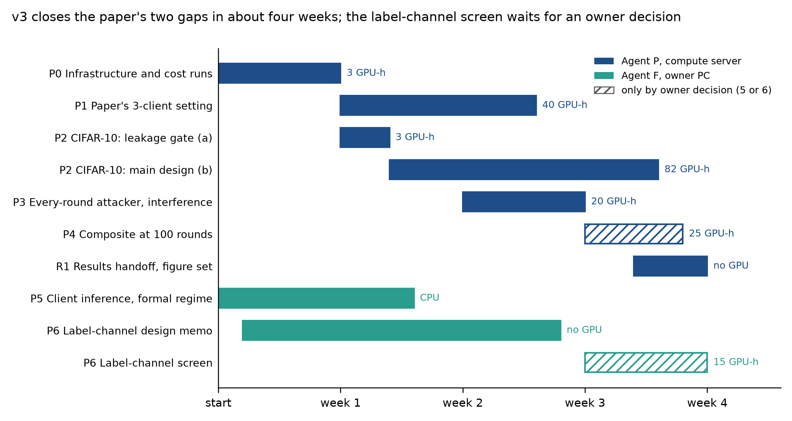

# Research roadmap v3: finishing the hybrid paper, and a gated start on a label-channel defense

Version 1, 2026-10-30. Status: **approved by the owner on 2026-10-30 (Section 1 defaults accepted as written); agents
may start.**

Built on:
- `HANDOFF_AUDIT.md`: the v2 handoff, checked and corrected;
- `NOVELTY_CHECK.md`: answers to handoff questions Q1-Q9;
- `reanalysis/FINDINGS.md`: zero-GPU checks on v2 runs;
- `PAPER_OPTIONS.md` and `DIRECTIONS.md`.

Process rules from `research/cia_roadmap_v2/ROADMAP.md` carry over unless changed here: a protocol before any run,
fixed gates, one declared extension, `ESCALATION.md` to stop, agents never merge into `master`, no `Co-Authored-By`.

## 0. Why a v3

Roadmap v2 closed on 2026-10-30 with no remaining package (decision 17). Its results support two claims that are both
strong and unpublished:
- **A-3:** metric privacy leaks like global DP at matched accuracy.
- **D-4:** client subsampling with logit adjustment leaks about 0.10 AUC less than metric privacy at matched accuracy.

D-4 survives an attacker who knows the sampling schedule: -0.071 [-0.113, -0.030] and -0.082 [-0.135, -0.030]
(`reanalysis/FINDINGS.md`). Only a hybrid paper (audit spine plus a positive section) uses both claims
(`PAPER_OPTIONS.md`).

Two gaps keep the paper from being defensible:
- The published paper's own 3-client setting was never measured under standard v2.
- Every leakage result rests on one dataset (EuroSAT), because Alzheimer leaks at chance even without noise.

v3 closes these two gaps, adds three cheap robustness checks, and opens the label-channel defense (the natural second
paper) only as a gated screen, because published mechanisms already compete with it (LDPM, RR-Label).

## 1. Owner decisions (approved 2026-10-30, binding: the proposed defaults, accepted unchanged)

| # | Decision | Proposed default | Alternatives |
|---|---|---|---|
| 1 | Paper form | **Hybrid**, with the audit as its spine (`PAPER_OPTIONS.md` Section 2.3). Decision 7's audit main line stays; D-4 becomes the positive section | Audit only (drops P2's composite cells and P3-P4); defense only (adds label-channel baselines, about 105-190 GPU-h) |
| 2 | Second dataset | **CIFAR-10**, label-Dirichlet 0.3, 48 slots. This reopens the 2026-10-10 decision that excluded CIFAR-10, because Alzheimer cannot discriminate (A-6). FEMNIST is the fallback if P2's leakage gate fails | FEMNIST first |
| 3 | Compute | **About 120 GPU-h expected, 150 cap** for P0-P3 and P5 on the compute server's two shared GPUs; per-package caps in Section 3; escalation at 1.25x | — |
| 4 | Agents | **Two.** Agent P runs the paper packages on the compute server. Agent F runs the formal-regime package and the label-channel design on the owner PC | One agent for everything (as at the end of v2) |
| 5 | Accuracy ceiling (P4) | **Run only if P2 passes and at least 25 GPU-h of the cap remain**; otherwise report the 0.772 ceiling as a limitation | Always; never |
| 6 | Label-channel defense (P6) | **Design memo only** in v3. Its screen runs only after the paper packages close, by a new owner decision | Screen in parallel |
| 7 | Carried-over decisions | All of v2's: participation secret (public slot count; noise independent of who participates), equal weights, top decile by size, EuroSAT alpha 0.3 primary, randomized inclusion, decisions 7-17 | — |
| 8 | "Beats metric privacy" | **Decision 9 unchanged:** all-candidate AUC at least 0.05 lower at matched accuracy, 97.5% pair-jackknife interval below 0, `R = 32`. For subsampled mechanisms the sampling-aware attacker is reported, and the claim is stated for it if it differs | — |

## 2. Measurement standard v3

Standard v2 (`research/cia_roadmap_v2/ROADMAP.md` Section 2 and decision 9) stays binding, with these additions:

1. **Design statement from the manifests.** The design is 32 candidates (top decile plus 27 by size quantile); each
   replicate includes 16, and the other 16 slots always take part. That gives 32 active of 48 slots and 1,024 trials
   per configuration at `R = 32`. Protocols copy this from the runner, not from ROADMAP v2 Section 2's pre-M0 text
   (`HANDOFF_AUDIT.md` C1).
2. **Power.** Paired matched-accuracy differences are detectable at about 0.03-0.04 for all candidates and 0.09-0.10
   for the top decile (A1 `power.py`); unpaired comparisons at about 0.09. Each protocol states which one applies
   (C2).
3. **Sampling-aware attacker.** Every mechanism with per-round client sampling is also scored by the sampling-aware
   attacker of `research/cia_roadmap_v3/reanalysis/reanalyze.py` (`sampling_aware`), with its centred window-drop
   statistic. A "beats" claim names the attacker it holds for.
4. **Every-round logging.** New runs of subsampled mechanisms score shadow losses at every round (51 checkpoints), so
   that a per-round attacker can be fitted. The gated attacker stays the 11-checkpoint one, for comparability with v2.
5. **Unbracketed targets.** A decision rule must state what happens when a curve does not reach a target accuracy.
   Default: that target is "not testable" and does not count as a pass. A comparison with no testable target is
   "not testable" (lesson from the early-stopping control).
6. **Fairness alongside.** Every matched-accuracy table reports the lowest-client accuracy interpolated at the same
   targets (`HANDOFF_AUDIT.md` C8). It is not gated.
7. **Reproduction first.** Any new analysis code must reproduce one published v2 number to 3 decimals before it reports
   anything new, as `reanalyze.py` does for C1.

## 3. Work packages

Cost unit: GPU-h of measured occupancy. v2 measured about 0.1 GPU-h per randomized-inclusion EuroSAT run, i.e. about
3 GPU-h per 32-replicate configuration (M2, A1, B5), and less for subsampled runs (B1: 9.9 GPU-h for 256 runs).
Small federations train the whole dataset every round, so they are not cheap.

| WP | Direction | Agent | Branch | Depends on | Cap (GPU-h) | Gate |
|---|---|---|---|---|---|---|
| P0 Infrastructure and cost runs | — | P | `feature/cia-v3-infra` | approval | 3 | G-P0 |
| P1 The paper's 3-client setting | F3 | P | `feature/cia-v3-paper-setting` | G-P0 | 40 | G-P1 (report) |
| P2 CIFAR-10 replication of A-3 and D-4 | F2 | P | `feature/cia-v3-cifar10` | G-P0 | 85 | G-P2a, G-P2b |
| P3 Every-round attacker and interference check | F4 | P | `feature/cia-v3-robustness` | G-P0 | 20 | G-P3 |
| P4 Composite at 100 rounds | F5 | P | `feature/cia-v3-ceiling` | G-P2b, decision 5 | 25 | G-P4 |
| P5 Client inference in the formal regime | F7 | F | `feature/cia-v3-formal-cia` | approval | CPU only | G-P5 (report) |
| P6 Label-channel defense: design memo, then screen | F1 | F | `feature/cia-v3-label-channel` | memo: approval; screen: a new owner decision | memo: 0; screen: 15 | G-P6 |
| R1 v3 results handoff and paper figure set | — | P | `docs/cia-v3-results` | all closed packages | 0 | none |

**Totals.**
- P0-P3 and P5: cap 148 GPU-h. Expected 87-147 from the per-package estimates, about 120 at the midpoints.
- With P4 and P6's screen: cap 188.

Results directories are `results/cia_v3/<package>/`, each with `PROTOCOL.md`, `STATE.md`, `FINDINGS.md` (at most
two plain-language claims, each with one plot), an analysis JSON and figures. Derived tables go in `tables/`, not
`data/`, because of the repo-wide ignore rule.

### P0 Infrastructure and cost runs (Agent P)

1. **Every-round shadow scoring** in `results/cia_v2/randomized_inclusion/runner.py`: a `--checkpoint-every 1` option.
   The default stays 5, so committed runs remain reproducible.
2. **IN-count option.** A balanced design with 8 or 24 candidates IN per replicate, at a public slot count fixed per
   configuration.
3. **CIFAR-10 label-Dirichlet data module** for the runner, built from `experiments/reproduce/dataset/cifar10.py`.
   Its partition summary is committed as for EuroSAT (`partition_summary`).
4. **Paper-protocol runner** for 3-client Alzheimer federations, from the plan suite's Alzheimer modules
   (`results/contest_at_scale/plan_suite/`). It runs IN/OUT pairs with separate `noise_seed` and `client_seed` per
   world, and scores the paper's pooled-checkpoint statistic as well as the calibrated attacker.
5. **Cost runs.** One run each of CIFAR-10 RI vanilla, CIFAR-10 RI composite, a 3-client Alzheimer paper-protocol pair,
   and a 51-checkpoint EuroSAT composite run. Costs are recorded in `STATE.md`; caps are re-checked against them.

**G-P0.**
- `uv run pytest` is green.
- `reanalyze.py` still reproduces C1's published gate numbers.
- The CIFAR-10 partition is deterministic in its seed.
- The IN-count design passes the runner's design checks.
- All four cost runs are recorded.

### P1 The paper's 3-client setting (Agent P; F3)

**Design.**
- 3-client Alzheimer, the paper's aggregation, rounds and noise for global DP and metric privacy, plus vanilla.
- 20 independent IN/OUT pairs per mechanism: 120 runs.
- No two worlds share private randomness.

**Statistics.**
1. The paper's pooled-checkpoint ROC per pair: its distribution, with the 5th-95th percentile range.
2. The calibrated attacker over the 40 trajectories per mechanism, with leave-one-pair-out references and a 95%
   interval.

**G-P1 (report; no kill).**
- If the calibrated attacker's lower bound is above 0.5 for both DP mechanisms: "the published protection claim fails
  in its own setting".
- If the paper's statistic spans 0.5 across pairs: "Table 13 is a single draw from a wide distribution".
- Otherwise: "consistent with the paper", and the audit rests on A-3 alone.

**Machine.** Compute server by default. The owner PC is allowed by the 8-client rule if P0's cost run shows it
finishes within 2 days.

### P2 CIFAR-10 replication (Agent P; F2)

**Design.**
- M2's randomized-inclusion design on CIFAR-10.
- Stage a: vanilla at `R = 8`.
- Stage b: vanilla, global DP at 3 levels, metric privacy at 3 levels and the composite at 3 levels, all at `R = 32`,
  with levels from an accuracy pilot (two runs per level).
- Targets: global DP's mean accuracy at its 2x and 4x levels, as on EuroSAT.

**G-P2a.** Vanilla all-candidate AUC at least 0.65 at `R = 8`. Otherwise stop, write `ESCALATION.md` and propose
FEMNIST (decision 2).

**G-P2b.**
- G-A1 for metric privacy against global DP, reported.
- G-C1 for the composite against metric privacy, under the standard and the sampling-aware attacker.

**Cap and spend.** 85 GPU-h; stop and escalate at 106. Stage a about 3 GPU-h.

### P3 Every-round attacker and interference check (Agent P; F4)

**Design.**
- 2 composite levels (the two bracketing 0.740 on EuroSAT) and 2 metric-privacy levels, `R = 32`, every-round
  scoring.
- One global-DP level (2x) with 8 and with 24 candidates IN.

**G-P3.**
- (a) The every-round sampling-aware attacker: G-C1's rule for the composite against metric privacy at 0.740 and
  0.660, where bracketed.
- (b) |AUC(8 IN) - AUC(24 IN)| at most 0.03, by the pair jackknife at 97.5%. If not, escalate before P2b's
  analysis: measurement standard v3 then needs an IN-count correction.

### P4 Composite at 100 rounds (Agent P; F5; only if decision 5 allows)

**Design.** The composite and metric privacy at 100 rounds, 3 levels each, after an accuracy pilot.

**G-P4.**
- The pilot reaches at least 0.78 mean accuracy; otherwise report the ceiling and stop.
- Then G-C1 at 0.780 and at the highest common target.

### P5 Client inference in the formal regime (Agent F; F7)

**Design.**
- B4's frozen-feature linear head (`results/cia_v2/formal_regime/`), with randomized-inclusion client inference.
- Mechanisms: global DP at `mu` in {1, 2, 4}, the same noise under metric privacy's distance calibration, and Poisson
  subsampling at `q = 0.25`.
- CPU only.

**G-P5 (report).**
- Global DP at `mu = 2` with an AUC upper bound of at most 0.60: "protective regime confirmed".
- The matched-accuracy differences between the three mechanisms are reported with the pair jackknife.

### P6 Label-channel defense (Agent F; F1)

1. **Design memo** (`research/cia_roadmap_v3/label_channel/DESIGN.md`):
   - the guarantee targeted: LDPM's label distributional privacy, or client-level DP on the released label prior;
   - the local objective;
   - how it differs from LDPM (Jiang et al., S&P 2024, stated for one-vs-all models) and RR-Label (Zheng and Li,
     TDSC 2023);
   - the formal statement to be proved;
   - LDPM's full text, which needs the owner's institutional access.
2. **Screen**, only after a new owner decision: RR-Label and one label-prior variant at 2 levels on EuroSAT,
   `R = 32`, full participation.

**G-P6.** At 0.740, at least 0.05 below metric privacy (decision 9's rule) and no worse than the composite by more
than 0.03 (point estimate). Fail: the second paper does not start.

### R1 Results handoff (Agent P)

Written after the last package closes:
- `research/cia_roadmap_v3/RESULTS_HANDOFF.md`, in the corrected v2 handoff's format, every number quoted from a
  committed report;
- the hybrid paper's figure set, one figure per claim.

## 4. Decision flow

| After | If | Then |
|---|---|---|
| G-P0 | fail | Nothing else runs |
| G-P1 | any outcome | Recorded; it sets the audit section's headline |
| G-P2a | fail | Escalate; FEMNIST replaces CIFAR-10 by owner decision (same design) |
| G-P2b | A-3 and D-4 replicate | The hybrid paper is complete on two datasets; R1 |
| G-P2b | A-3 replicates, D-4 does not | The positive section is stated for EuroSAT only, with CIFAR-10 as a bound; the owner reconsiders decision 1 |
| G-P2b | A-3 does not replicate | Escalate: the audit's central claim becomes dataset-specific |
| G-P3(a) | fail | D-4 is stated for attackers without per-round access |
| G-P3(b) | fail | Escalate before P2b's analysis |
| G-P5 | any outcome | Reported in the paper's formal-regime paragraph |
| G-P6 | pass | The owner may open a v4 label-channel programme (second paper) |

## 5. Calendar (indicative)

| Week | Agent P (compute server) | Agent F (owner PC) |
|---|---|---|
| 1 | P0 (code, tests, cost runs) | P5; P6 design memo |
| 2 | P1 on GPU 1; P2 stage a and accuracy pilot on GPU 0 | P5 findings |
| 3 | P2 stage b on GPU 0; P3 on GPU 1 | P6 memo review with the owner |
| 4 | P2 analysis; P4 if allowed; R1 draft | (P6 screen only by owner decision) |



## 6. Agent organisation

| Agent | Owns (edit only these) | Packages |
|---|---|---|
| P | `results/cia_v2/randomized_inclusion/` (the new options only, backward compatible), new data modules for CIFAR-10, the paper-protocol runner, `results/cia_v3/{infra,paper_setting,cifar10,robustness,ceiling}/`, `research/cia_roadmap_v3/RESULTS_HANDOFF.md` | P0-P4, R1 |
| F | `results/cia_v3/{formal_cia,label_channel}/`, `research/cia_roadmap_v3/label_channel/`, head-only code under `experiments/` | P5, P6 |

**Coordination.**
- The v2 coordination rules apply: a `STATE.md` per package, read with `git show`; `ESCALATION.md` to stop; each agent
  edits only its own `STATUS.md` rows.
- Agent P pins GPUs with `CUDA_VISIBLE_DEVICES` and checks that a GPU is free of other users' jobs before adding
  workers. Out-of-memory handling as in C1: one worker and 4 parallel clients after any failure.
- Changes to decisions, caps or GPU assignments go into this file, are committed and pushed, and the agents are told
  to pull. They are never given only in a chat prompt.

## 7. Agent prompts

**Shared opening (paste first in every session)**

```
You are an autonomous research agent on this repository. Follow AGENTS.md. Then read, in order:
HANDOFF.md; research/cia_roadmap_v3/README.md; research/cia_roadmap_v3/ROADMAP.md (Sections 0-4 and 6, and your
packages in Section 3); research/cia_roadmap_v2/RESULTS_HANDOFF.md (corrected 2026-10-30);
research/cia_roadmap_v3/HANDOFF_AUDIT.md; research/cia_roadmap_v3/reanalysis/FINDINGS.md.
The owner decisions in ROADMAP.md Section 1 and the measurement standard in Section 2 (v2's plus the v3 additions) are
binding. Work through your packages in order, obey gates, caps, file ownership and escalation rules, and never merge
into master. Open your own sparse worktree for each branch (.agents/skills/worktrees/SKILL.md).
Before your first code change, write your package's STATE.md and reply with five bullets: hypothesis; design (worlds,
replicates, and a statement that no private randomness is shared between worlds); attacker and metrics; the gate rule
copied verbatim, including what happens to untestable targets; files you will touch.
```

**Agent P (paper packages)**

```
You are Agent P. Packages: P0 (feature/cia-v3-infra), then P1 (feature/cia-v3-paper-setting) and P2
(feature/cia-v3-cifar10) in parallel on the two GPUs, then P3 (feature/cia-v3-robustness), then P4 only if
ROADMAP.md decision 5 allows, then R1. P0 blocks everything you do: launch nothing beyond P0's four cost runs until
G-P0 passes. Before any new analysis reports a number, reproduce one published v2 number to 3 decimals. Machine:
compute server.
```

**Agent F (formal regime and label-channel design)**

```
You are Agent F. Packages: P5 (feature/cia-v3-formal-cia, CPU only) and the P6 design memo
(feature/cia-v3-label-channel). Do not run P6's screen unless ROADMAP.md Section 10 records an owner decision opening
it. Machine: owner PC. Do not edit files Agent P owns.
```

## 8. Risks

| Risk | Effect | Mitigation |
|---|---|---|
| CIFAR-10 does not leak under standard v2 | No second dataset | G-P2a at 3 GPU-h; FEMNIST fallback |
| Small-federation runs cost more than estimated | P1 overruns | P0 cost run; owner PC allowed; 1.25x escalation |
| Interference between included candidates | All v2 AUCs are biased by IN count | P3(b) before P2b's analysis |
| Every-round attacker breaks D-4 | Positive section narrows | Stated for attackers without per-round access; the audit stands on its own |
| Shared GPUs (other users) | Delays and out-of-memory failures | `--require-all-clients`; one worker after any failure; idle-GPU checks |
| LDPM not reproducible from its abstract | P6 cannot benchmark it | RR-Label as the implementable baseline; the owner fetches the full text |

## 9. References added in v3

The full list is in `references_v3.bib` and `tables/novelty_evidence.csv`. Those that change the plan:
- Jiang et al. 2024, LDPM, [10.1109/sp54263.2024.00113](https://doi.org/10.1109/sp54263.2024.00113): a
  label-distribution privacy mechanism, P6's main competitor.
- Zheng and Li 2023, CMI and RR-Label, [10.1109/tdsc.2023.3346692](https://doi.org/10.1109/tdsc.2023.3346692):
  DP-SGD fails under label skew; a label randomized-response defense.
- Keinan et al. 2025, [10.52202/085713-1632](https://doi.org/10.52202/085713-1632): interference limits one-run audit
  power, motivating P3(b).
- Jayaraman and Evans 2019, [10.48550/arxiv.1902.08874](https://doi.org/10.48550/arxiv.1902.08874), and Aerni et al.
  2024, [10.1145/3658644.3690194](https://doi.org/10.1145/3658644.3690194): the matched-utility framing for A-3.
- Liu et al. 2021, [10.48550/arxiv.2110.05524](https://doi.org/10.48550/arxiv.2110.05524): early stopping as an
  empirical defense, the reason for the early-stopping control.

## 10. Owner decisions after approval

Decisions taken during v3 are recorded here, dated and numbered from 1.

| # | Decision |
|---|---|
| 1 | **2026-10-30: Section 1 approved as written.** The defaults of decisions 1-8 are binding: hybrid paper, CIFAR-10 second dataset, about 120 GPU-h expected with a 148 GPU-h cap for P0-P3 and P5, Agent P on the compute server, Agent F on the owner PC, P4 conditional, P6 design memo only. Agents may start. |
