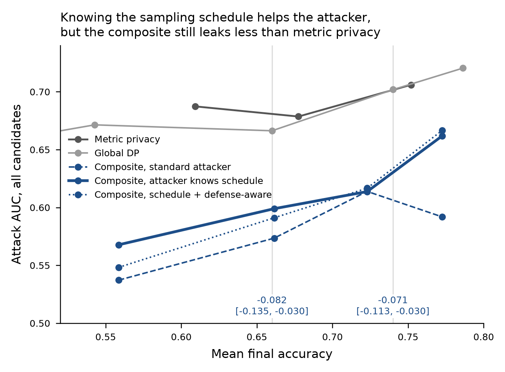
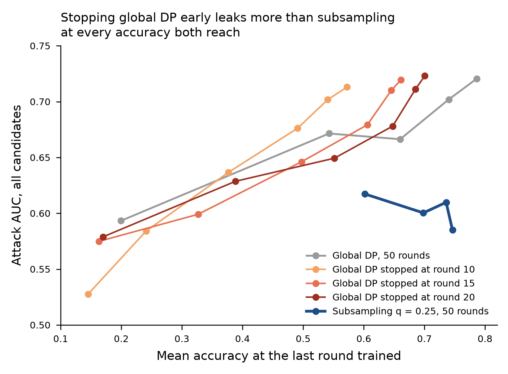

# Re-analysis findings: sampling-aware attacker, early-stopping control, per-candidate breakdown

Protocol: `PROTOCOL.md` (fixed 2026-10-30, commit `d6f672e1`; amendment `9f1cccaf` before any real-data statistic).
Numbers: `analysis.json` (from `reanalyze.py`) and `exploratory.json` (from `exploratory.py`, not pre-registered).
Inputs: the committed M2, A1, B1 and C1 runs at master `c885c13f`. CPU only, about 50 s; no run was launched.

**Claim 1. An attacker who knows when each client is sampled does better against the composite, but the composite
still leaks clearly less than metric privacy at the same accuracy.** Against metric privacy, the gap narrows from
-0.095 to -0.071 at 0.740 accuracy and from -0.108 to -0.082 at 0.660, and both intervals stay
below zero. The pre-registered decision is **survives**. Subsampling *alone* loses its win at 0.660 under this
attacker, so if the schedule can leak, the composite (not subsampling alone) is the mechanism to report.

**Claim 2. Training fewer rounds is not what makes subsampling work.** Global DP stopped after 10, 15 or 20 rounds
leaks more (AUC 0.68-0.72) than subsampling (0.60-0.62) at every accuracy both reach, and it cannot reach 0.740
accuracy at all within 20 rounds. The pre-registered decision is **inconclusive**, only because no target is
reachable at 10 rounds (see (b)).

## (a) Sampling-aware attacker

**Check.** Realized IN sampling fractions: 0.248-0.253 for `q = 0.25`
(B1 and C1), 0.499-0.505 for `q = 0.5`, all within 0.02 of `q`. The schedule mapping
(`client-ids` index the active view) was checked on all 205,512 sampled-client entries: every logged example count
is 80% (±0.5%) of that client's records in the seed-42 layout.

**Reproduction.** On the standard attacker the implementation reproduces C1's published gate numbers against metric
privacy to 3 decimals (-0.095 [-0.137, -0.053] and -0.108 [-0.163, -0.053]).

**Matched accuracy** (pair jackknife 97.5%; two-way bootstrap 95%):

| Comparison | `a*` = 0.740 | `a*` = 0.660 |
|---|---|---|
| **C1 (sampling-aware) vs metric privacy (standard)**, deciding | **-0.071 [-0.113, -0.030]; two-way [-0.136, -0.011]** | **-0.082 [-0.135, -0.030]; two-way [-0.154, -0.016]** |
| C1 vs metric privacy, standard attacker (published) | -0.095 [-0.137, -0.053] | -0.108 [-0.163, -0.053] |
| C1 (sampling-aware) vs metric privacy, top decile | -0.014 [-0.106, 0.078]; two-way [-0.119, 0.107] | -0.059 [-0.140, 0.022]; two-way [-0.198, 0.052] |
| B1 `q = 0.25` (sampling-aware) vs global DP | -0.067 [-0.114, -0.020]; two-way [-0.132, -0.001] | -0.028 [-0.073, 0.018]; two-way [-0.084, 0.029] |
| B1 `q = 0.25` (sampling-aware) vs metric privacy | -0.067 [-0.109, -0.026]; two-way [-0.135, -0.009] | -0.042 [-0.078, -0.006]; two-way [-0.095, 0.009] |
| B1 `q = 0.25` (standard) vs global DP (reproduces B1) | -0.102 [-0.164, -0.040]; two-way [-0.166, -0.040] | -0.059 [-0.096, -0.022]; two-way [-0.105, -0.011] |

**Decision** (PROTOCOL.md): survives.
- The point estimate rises by 0.024 at 0.740 and 0.026 at 0.660, both below the 0.03 that would mark it "weakened".
  The margin is small.
- The top-decile gain at 0.740 is gone under this attacker (point estimate -0.014).

**Per configuration** (same trials; SA minus standard, pair jackknife 97.5%):

| Config | Accuracy | Standard AUC | Sampling-aware AUC | Schedule statistic alone | SA - standard |
|---|---|---|---|---|---|
| `b1-q0.25-r0.0001` | 0.746 | 0.585 | 0.627 | 0.584 | +0.042 [-0.010, 0.093] |
| `b1-q0.25-r0.000773` | 0.736 | 0.610 | 0.640 | 0.570 | +0.030 [-0.009, 0.069] |
| `b1-q0.25-r0.003092` | 0.698 | 0.600 | 0.619 | 0.577 | +0.019 [-0.019, 0.057] |
| `b1-q0.25-r0.006184` | 0.602 | 0.617 | 0.669 | 0.576 | +0.051 [0.017, 0.086] |
| `b1-q0.5-r0.001546` | 0.768 | 0.647 | 0.687 | 0.538 | +0.040 [0.013, 0.067] |
| `b1-q0.5-r0.003092` | 0.730 | 0.673 | 0.696 | 0.554 | +0.023 [0.004, 0.042] |
| `b1-q0.5-r0.006184` | 0.640 | 0.635 | 0.671 | 0.591 | +0.036 [0.001, 0.070] |
| `b1-q0.5-r0.012368` | 0.519 | 0.650 | 0.662 | 0.522 | +0.011 [-0.005, 0.028] |
| `c1-r0.000773` | 0.772 | 0.592 | 0.662 | 0.598 | +0.070 [0.029, 0.111] |
| `c1-r0.003092` | 0.723 | 0.614 | 0.614 | 0.507 | -0.000 [-0.031, 0.031] |
| `c1-r0.006184` | 0.661 | 0.574 | 0.599 | 0.555 | +0.025 [-0.014, 0.065] |
| `c1-r0.012368` | 0.559 | 0.537 | 0.568 | 0.487 | +0.031 [-0.002, 0.063] |

Knowing the schedule raises the AUC by 0.00-0.07. The schedule statistic alone is a weak attacker (AUC 0.49-0.60):
it adds information to the loss trajectory rather than replacing it.

**Exploratory, not pre-registered** (`exploratory.json`):
- **Logit adjustment under this attacker.** C1 against B1 `q = 0.25`, both sampling-aware:
  -0.004 [-0.052, 0.044]; two-way [-0.070, 0.067] at 0.740 and -0.040 [-0.083, 0.002]; two-way [-0.113, 0.031] at 0.660. No detectable
  difference. A privacy role for logit adjustment when the schedule leaks is suggested at 0.660, not shown.
- **Strongest available attacker.** Logit-adjusted shadow losses plus the schedule statistic, C1 against metric
  privacy: -0.068 [-0.105, -0.031]; two-way [-0.129, -0.011] at 0.740 and -0.090 [-0.139, -0.042]; two-way [-0.160, -0.030] at 0.660.

## (b) Early-stopping control

Global DP is stopped after `T` rounds, with an attacker restricted to the checkpoints up to `T`. Its highest reachable
accuracy is the no-noise point. B1 `q = 0.25` is compared with it at each target:

| `T` | Highest accuracy | `a*` = 0.740 | `a*` = 0.700 | `a*` = 0.660 |
|---|---|---|---|---|
| 10 | 0.572 | not bracketed | not bracketed | not bracketed |
| 15 | 0.661 | not bracketed | not bracketed | -0.112 [-0.141, -0.082]; two-way [-0.163, -0.062] (1320 of 2,000) |
| 20 | 0.701 | not bracketed | -0.122 [gate not computable]; two-way [-0.182, -0.061] (1263 of 2,000) | -0.082 [-0.113, -0.051]; two-way [-0.131, -0.033] (2000 of 2,000) |

Composite (C1) against the same comparator, at the bracketed targets:
- `T = 15`, 0.660: -0.146 [-0.209, -0.082]; two-way [-0.229, -0.065] (1320 of 2,000).
- `T = 20`, 0.700: -0.124 [gate not computable]; two-way [-0.184, -0.063] (1263 of 2,000).
- `T = 20`, 0.660: -0.116 [-0.177, -0.055]; two-way [-0.195, -0.037] (2000 of 2,000).

**Decision: inconclusive.**
- **Why:** at `T = 10` no target is bracketed (the highest accuracy is 0.572).
- **What the rule requires:** "specific to sampling" asks for a pass at every bracketed target for both `T = 10` and
  `T = 15`.
- **The ambiguity:** the written rule does not say how to treat a `T` with no bracketed target. The committed code
  reads that case as not passing, hence "inconclusive". Under the vacuous reading the result would be "specific to
  sampling".
- **Every bracketed comparison favours subsampling by 0.08-0.15 AUC.** At `T = 20`, 0.700, the gate jackknife could not
  be formed because some leave-one-pair-out curves no longer reach 0.700. The two-way bootstrap is given instead.
- **The comparator's attacker sees fewer checkpoints.** That biases the test towards the comparator, so the
  subsampling gain is, if anything, understated.
- **Stopping early does not lower leakage at matched accuracy.** In the accuracy range where subsampling operates
  (0.60-0.75), early-stopped global DP leaks more than 50-round global DP at the same accuracy (for example 0.72
  against about 0.67 at 0.66). Cutting the number of contributions in time is therefore not a substitute for sampling.
  At very low accuracy (around 0.33) the order can reverse.

## (c) Per-candidate breakdown (descriptive)

C1 minus metric privacy, per candidate (32 candidates, each AUC on 16 IN and 16 OUT trials):

| `a*` | Median difference | Candidates with a gain | Spearman with records | Spearman with label entropy |
|---|---|---|---|---|
| 0.740 | -0.140 | 78% | +0.15 (p 0.42) | -0.07 (p 0.70) |
| 0.660 | -0.150 | 62% | +0.17 (p 0.35) | -0.18 (p 0.33) |

The gain is spread over most candidates and is not concentrated in large clients or in clients with skewed label
mixes. Per-candidate AUCs are noisy, and their median is not the pooled AUC difference, so only the pattern is read.

## What this changes

- **The defense claim now holds for an attacker who knows the sampling schedule**, as long as it is stated for the
  composite. Subsampling alone is not robust to a leaked schedule at 0.660.
- **"Subsampling is just early stopping" is answered for the reachable range.** A paper can cite (b), with its stated
  ambiguity.
- **Two v3 items follow:**
  - The re-analysis used 11 checkpoints. An attacker that sees every round's model could exploit the schedule more
    strongly, which is a reason to log shadow losses at every round in v3 runs of subsampled mechanisms.
  - The top-decile gain is fragile under the sampling-aware attacker. It needs more replicates or a larger panel of
    large clients before it can be claimed.
