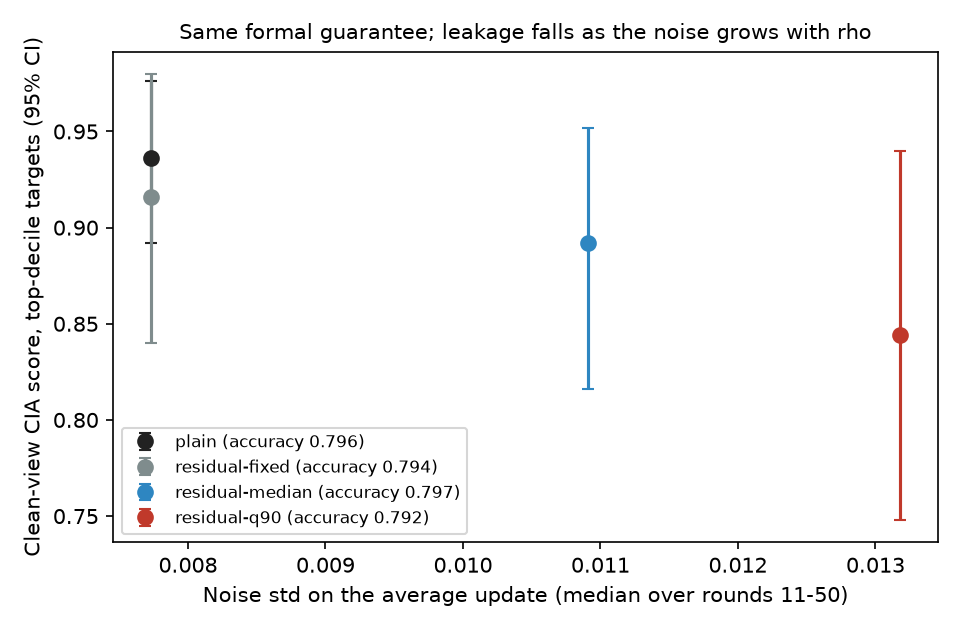
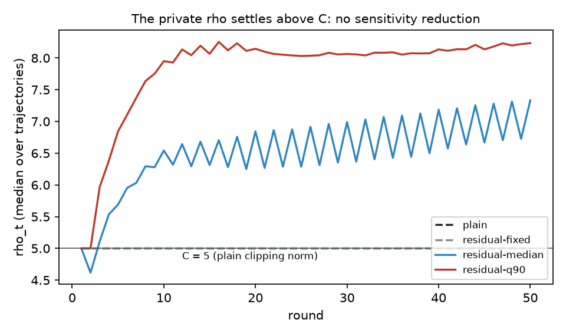

# WP6 (D4 item 2) findings: residual clipping around the previous release

Branch `feature/residual-clipping`. Protocol `PROTOCOL.md` (committed at 8b86be69 before any run), proof and pre-run
prediction `THEORY.md`, pre-analysis `pre_analysis.py`/`.csv`. Gate G6: **passed as written, but not through the
mechanism D4 item 2 proposes** (claims 1-2). Every number below comes from `analysis.json` (written by `analyze.py`
from the 24 committed trajectories) through `findings.py`, which also writes `findings_tables.md` (reproduced below).

Setup: EuroSAT, label-Dirichlet alpha 0.3, 48 slots, seed 42, 50 rounds, equal weights with the public slot count as
denominator, the five top-decile clients (23, 7, 40, 18, 33) as targets, four mechanisms at the same formal guarantee
(13.48-GDP per round, 95.3 over 50 rounds, vacuous like every committed DP run in this repository).

## Claim 1: at the same formal guarantee, the residual-clipping variants leak less than plain clipping, at no accuracy cost

Plain clipping (C = 5) gives a top-decile clean-view score of 0.936 [0.892, 0.976] at accuracy 0.796. Residual clipping
with a private median `rho` gives 0.892 (reduction 0.044 [0.012, 0.080]) at 0.797, and with a private 90% quantile
0.844 (reduction 0.092 [0.032, 0.152]) at 0.792. Both hold G6 (at most 2 pp accuracy loss and a reduction whose
interval excludes 0), so **G6 passes**. The AUC agrees (reductions 0.025 [0.011, 0.042] and 0.057 [0.006, 0.123]).

## Claim 2: the reduction comes from more noise, not from lower sensitivity

The method was meant to clip residuals to `rho < C` so the server could add less noise. The opposite happened, as
`THEORY.md` predicted before the runs: the centre carries the previous round's noise, and clients' updates in this
federation spread about as widely as their own size, so residual norms (median 6.58 and 7.72 over rounds 11-50) and the
private `rho` settle **above** C (6.69 and 8.09). The noise, which scales with `rho` at a fixed guarantee, is 1.41 and
1.70 times plain clipping's. Centring alone at plain clipping's noise (`residual-fixed`, descriptive) reduces the score by
only 0.020 [-0.016, 0.056] and clips 62% of the residuals. Leakage falls in step with the noise. At this vacuous
guarantee the extra noise costs no accuracy, so G6's "same guarantee" comparison credits the variant with lower
measured leakage. The worst-case guarantee is the same, but the noise is calibrated to a larger `rho` than typical
updates need, which lowers realized leakage for every client whose update is smaller than `rho`. Plain clipping with a
larger clipping norm at the same `z` would very likely show the same effect; that control was not in the protocol.

## Further observations

- **Prediction check.** `THEORY.md` predicted `rho` about 7 and noise about 1.5x plain for the median variant
  (measured 6.69 and 1.41x) and a G6 fail through accuracy or clipping bias. The mechanism prediction held; the gate
  prediction did not, because the extra noise did not cost accuracy at this noise level.
- **Tracker dynamics.** The median-tracked `rho` oscillates with period 2 around a slowly rising level (geometric step
  0.2), while the 90%-quantile `rho` is steady after round 10.
- **Per target.** The reductions are largest for clients 23 and 18 (q90: 0.86 to 0.70, 0.92 to 0.74); client 40 stays at
  0.98-1.00 under every mechanism.
- **Accuracy.** IN-trajectory accuracy is slightly higher for the residual variants (0.811 and 0.813 vs 0.802), mean
  accuracy over all six trajectories is within 0.5 pp.
- **Formal value.** The pre-run analysis (`THEORY.md` Section 3) shows the inherited noise can be absorbed only when
  `1/z > sqrt(d)/n` (11.2 here), i.e. only at vacuous guarantees. At a meaningful guarantee the centre's noise would
  dominate every residual.

## Consequences

The roadmap says on a pass: record; the owner decides on composition with D1. D1 stopped after WP2, so there is nothing
to compose with. Recommendation: do not present residual clipping as a sensitivity reduction. If the owner wants the
leakage effect explained, the declared next check is a plain-clipping control with the clipping norm set to the
measured `rho` (8.1) at the same `z`, which isolates "more noise for the same formal guarantee" from centring. That is
a new run and needs the owner's decision.

## Cost and execution

24 trajectories, 7.08 h of trajectory wall time (8.9 t-h planned, cap 60). Compute server, GPU 0. The first launch
was stopped within about two minutes because another user's job had started on that GPU; the owner then approved
sharing it. Smoke runs, the 24 runs and the analysis had no stalls or errors; nothing excluded.

---

| Mechanism | Score [95%] | AUC [95%] | TPR@5% | TPR@1% | Noisy score | Accuracy mean | IN accuracy | Range | rho (r11+) | Noise std (r11+) | Residuals clipped (r11+) | Median residual norm (r11+) |
|---|---|---|---|---|---|---|---|---|---|---|---|---|
| `plain` | 0.936 [0.892, 0.976] | 0.981 [0.946, 0.998] | 0.916 | 0.708 | 0.772 | 0.7963 | 0.8022 | 0.7815-0.8067 | 5.000 | 0.00773 | 0.000 | 2.968 |
| `residual-fixed` | 0.916 [0.840, 0.980] | 0.979 [0.934, 0.997] | 0.880 | 0.720 | 0.892 | 0.7936 | 0.8007 | 0.7778-0.8081 | 5.000 | 0.00773 | 0.619 | 5.115 |
| `residual-median` | 0.892 [0.816, 0.952] | 0.956 [0.906, 0.988] | 0.820 | 0.472 | 0.740 | 0.7972 | 0.8111 | 0.7867-0.8111 | 6.693 | 0.01091 | 0.499 | 6.581 |
| `residual-q90` | 0.844 [0.748, 0.940] | 0.923 [0.840, 0.988] | 0.664 | 0.216 | 0.692 | 0.7922 | 0.8126 | 0.7837-0.8126 | 8.087 | 0.01318 | 0.090 | 7.722 |

Per-target clean-view scores (seed-target):

| Mechanism | 42-7 | 42-18 | 42-23 | 42-33 | 42-40 |
|---|---|---|---|---|---|
| `plain` | 0.96 | 0.92 | 0.86 | 0.94 | 1.00 |
| `residual-fixed` | 0.98 | 0.94 | 0.78 | 0.88 | 1.00 |
| `residual-median` | 0.94 | 0.92 | 0.76 | 0.86 | 0.98 |
| `residual-q90` | 0.88 | 0.74 | 0.70 | 0.90 | 1.00 |

Against plain clipping (gate rows are G6; the `residual-fixed` row is descriptive):

| Mechanism | Score reduction [95%] | AUC reduction | Noise / plain | rho / plain | Accuracy difference | G6 verdict |
|---|---|---|---|---|---|---|
| `residual-fixed` | 0.020 [-0.016, 0.056] | n/a | 1.00 | 1.00 | -0.0027 | diagnostic |
| `residual-median` | 0.044 [0.012, 0.080] | 0.025 [0.011, 0.042] | 1.41 | 1.34 | +0.0009 | holds |
| `residual-q90` | 0.092 [0.032, 0.152] | 0.057 [0.006, 0.123] | 1.70 | 1.62 | -0.0041 | holds |

G6 = **pass**.

### Every trajectory (round-50 server accuracy, training and evaluation seconds):

| Mechanism | Trajectory | Accuracy | Training s | Evaluation s |
|---|---|---|---|---|
| `plain` | IN | 0.8022 | 926 | 500 |
| `plain` | OUT-18 | 0.7978 | 1017 | 89 |
| `plain` | OUT-23 | 0.7874 | 916 | 113 |
| `plain` | OUT-33 | 0.8067 | 1066 | 92 |
| `plain` | OUT-40 | 0.7815 | 996 | 89 |
| `plain` | OUT-7 | 0.8022 | 816 | 92 |
| `residual-fixed` | IN | 0.8007 | 1020 | 502 |
| `residual-fixed` | OUT-18 | 0.7970 | 859 | 80 |
| `residual-fixed` | OUT-23 | 0.7778 | 789 | 103 |
| `residual-fixed` | OUT-33 | 0.7985 | 858 | 82 |
| `residual-fixed` | OUT-40 | 0.7793 | 889 | 106 |
| `residual-fixed` | OUT-7 | 0.8081 | 879 | 110 |
| `residual-median` | IN | 0.8111 | 1043 | 449 |
| `residual-median` | OUT-18 | 0.7941 | 838 | 104 |
| `residual-median` | OUT-23 | 0.7867 | 1046 | 90 |
| `residual-median` | OUT-33 | 0.8015 | 843 | 103 |
| `residual-median` | OUT-40 | 0.7933 | 842 | 103 |
| `residual-median` | OUT-7 | 0.7963 | 772 | 106 |
| `residual-q90` | IN | 0.8126 | 883 | 504 |
| `residual-q90` | OUT-18 | 0.7874 | 851 | 98 |
| `residual-q90` | OUT-23 | 0.7837 | 805 | 101 |
| `residual-q90` | OUT-33 | 0.7919 | 845 | 93 |
| `residual-q90` | OUT-40 | 0.7881 | 873 | 113 |
| `residual-q90` | OUT-7 | 0.7896 | 867 | 116 |

24 trajectories, 7.08 h of trajectory wall time.
