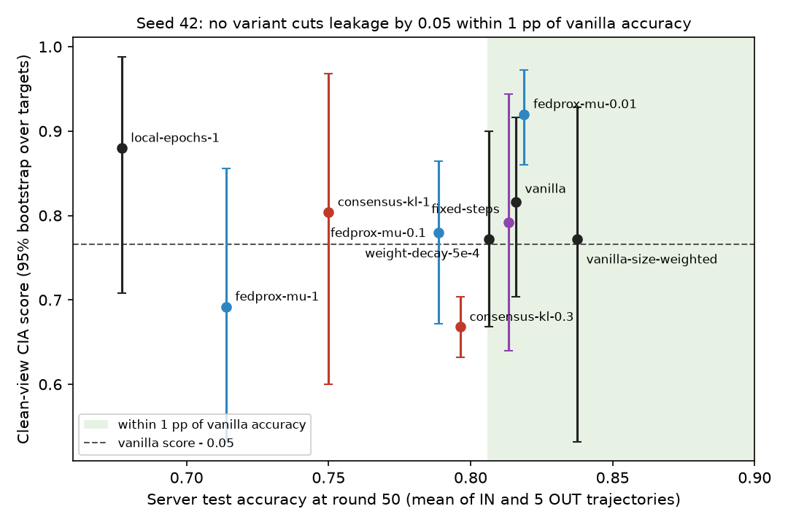
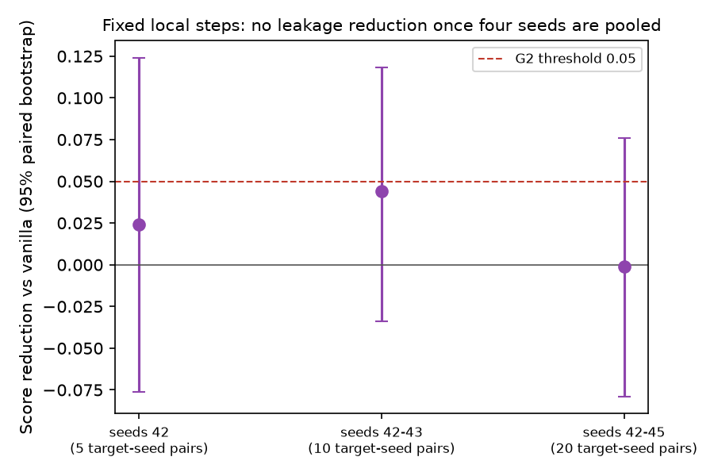

# WP2 (D1 Stage A) findings: signature-suppressing local training, screen

Branch `feature/signature-suppression`. Protocol `PROTOCOL.md` (committed at bb9bfd44 before any run; Amendments 1 and
2). Gate G2: **inconclusive** after the declared extension and the owner's extra seeds; owner decision 2026-10-15:
record Stage A as not supporting D1 and stop D1 (`ESCALATION.md`, option 1). Every number below comes from
`analysis.json` (seed 42), `analysis_seeds42-43.json`, `analysis_seeds42-45.json` and the trajectory folders under
`results/stage_a/`, through `findings.py`, which also writes the full tables in `findings_tables.md` (reproduced at the
end).

Setup: EuroSAT, label-Dirichlet alpha 0.3, 48 clients, 50 rounds, no DP, equal aggregation weights; removal adjacency
for five targets (23 and 7, the two largest clients; 3, 0, 1 spread over the size range). Leakage is the clean-view
CIA score: the fraction of rounds in which the target's shadow loss is lower when the target took part (0.5 = no
signal). Accuracy is the server test accuracy at round 50.

## Claim 1: no local-training change cut leakage enough without costing accuracy

At seed 42, vanilla (equal weights) scores 0.816 [0.704, 0.916] at accuracy 0.816. G2 asks for a cut of at least 0.05
within 1 pp of that accuracy (green band, below the dashed line), and for beating weight decay and one local epoch at
matched accuracy. No candidate does both:

- **Consensus KL, beta 0.3** is the only clear cut: score 0.668 [0.632, 0.704], reduction 0.148 [0.048, 0.224] (AUC
  0.170 [0.065, 0.238]), and it beats both controls at matched accuracy (+0.104 [0.012, 0.204] vs weight decay,
  +0.157 [0.050, 0.229] vs one local epoch). It costs 1.95 pp accuracy (0.796), over the 1 pp limit. It was run at
  seed 42 only.
- **FedProx** buys leakage only with accuracy: mu 0.01 leaks more (0.920, reduction -0.104 [-0.172, -0.036]), mu 0.1
  scores 0.780 at -2.7 pp, mu 1 scores 0.692 at -10.2 pp. **Consensus KL beta 1** scores 0.804 at -6.6 pp.
- The controls do not help either: weight decay 0.772 at 0.807, one local epoch 0.880 at 0.677. Size-weighted vanilla
  (secondary reference) scores 0.772 at 0.838.

## Claim 2: fixed local steps, the only candidate left open, shows no effect at four seeds

Fixed steps (58 Adam steps per client per round, the vanilla mean) keeps accuracy (0.814 at seed 42, 0.825 over seeds
42-45) but its leakage reduction against vanilla is 0.024 [-0.076, 0.124] at seed 42, 0.044 [-0.034, 0.118] with the
declared seed-43 extension, and -0.001 [-0.079, 0.076] over seeds 42-45 (vanilla 0.762, fixed steps 0.763, weight
decay 0.763; 20 target-seed pairs). Against the controls at matched accuracy it is -0.001 and +0.001. The interval did
not narrow with more seeds because seeds 44-45 vary strongly between targets, so under the rule (interval must clear
0.05 to pass or lie below it to fail) the gate stays inconclusive; the point estimate is zero.

## Further observations

- **Mechanism check (D1, P2; descriptive).** FedProx shrinks each target's leave-one-out residual norm the most (target
  23: 3.85 vanilla, 2.33 / 1.21 / 0.59 for mu 0.01 / 0.1 / 1) without a matching drop in leakage at matched accuracy;
  consensus KL 0.3 lowers leakage while barely changing it (3.66). Within this screen, the residual-norm proxy does not
  track the CIA signal the way the first-order argument predicts.
- **Top-decile targets** (23 and 7) at seed 42: vanilla 0.820, consensus KL 0.3 0.650, fixed steps 0.770, FedProx mu 1
  0.590, one local epoch 0.990; over seeds 42-45 vanilla 0.865, fixed steps 0.795.
- **Fairness.** The lowest per-client held-out accuracy in the IN trajectory at seed 42 drops from 0.611 (vanilla) to
  0.545 (consensus KL 0.3), 0.453 (consensus KL 1) and 0.375 (FedProx mu 1, one local epoch).
- **Noisy view (secondary).** Scores move a lot between configurations (vanilla 0.796, fixed steps 0.428, consensus KL 1
  0.080 at seed 42), so the noisy-view shadow attack is not a stable ranking of these variants.
- **Variance.** With five targets, a single seed moves the vanilla score by several points (0.816 at seed 42, 0.762
  over seeds 42-45); screens of this size can confirm only large effects.

## Consequences (roadmap Section 3, owner decision)

D1 stops after Stage A: WP4 (D1 Stage B) does not start. The roadmap moves Agent B to WP6 (residual clipping), which
depends on WP3 (not started). The consensus-KL lead (a 0.148 cut at about 2 pp accuracy, one seed) is recorded here and
not carried forward.

## Cost and execution

132 trajectories, 34.48 h of trajectory wall time: 60 at seed 42 (15.54 h), 24 in the seed-43 extension (5.56 h), 48 at
seeds 44-45 (13.39 h); cap 30 t-h, +15% (below the 25% escalation line; the owner chose the extra seeds). Compute
server, up to three workers on two GPUs, no stalls or failed trajectories; nothing excluded. Smoke tests ran on the
compute server (2 rounds, scratch output) instead of the owner PC. FedProx uses the FedProx paper's sum convention
(PROTOCOL.md Section 3).

---

## Tables: Seed 42, all configurations (`analysis.json`, 5 clusters)

| Configuration | Role | Score [95%] | AUC [95%] | TPR@5% | TPR@1% | Noisy score | Top-decile score | Top-decile AUC | Accuracy mean | IN accuracy | Range | Client acc. min / mean (IN) |
|---|---|---|---|---|---|---|---|---|---|---|---|---|
| `vanilla` | reference | 0.816 [0.704, 0.916] | 0.898 [0.761, 0.981] | 0.556 | 0.264 | 0.796 | 0.820 | 0.937 | 0.8159 | 0.8067 | 0.8067-0.8244 | 0.611 / 0.807 |
| `vanilla-size-weighted` | secondary reference | 0.772 [0.532, 0.928] | 0.863 [0.637, 0.985] | 0.460 | 0.244 | 0.868 | 0.940 | 0.990 | 0.8375 | 0.8363 | 0.8341-0.8407 | 0.639 / 0.817 |
| `weight-decay-5e-4` | control | 0.772 [0.668, 0.900] | 0.863 [0.735, 0.961] | 0.456 | 0.224 | 0.856 | 0.740 | 0.890 | 0.8065 | 0.7993 | 0.7970-0.8230 | 0.617 / 0.791 |
| `local-epochs-1` | control | 0.880 [0.708, 0.988] | 0.936 [0.794, 0.999] | 0.744 | 0.308 | 0.372 | 0.990 | 0.999 | 0.6772 | 0.6852 | 0.6689-0.6852 | 0.375 / 0.671 |
| `fedprox-mu-0.01` | candidate | 0.920 [0.860, 0.972] | 0.960 [0.901, 0.995] | 0.860 | 0.204 | 0.704 | 0.910 | 0.970 | 0.8189 | 0.8067 | 0.8067-0.8333 | 0.624 / 0.803 |
| `fedprox-mu-0.1` | candidate | 0.780 [0.672, 0.864] | 0.849 [0.731, 0.950] | 0.328 | 0.124 | 0.904 | 0.870 | 0.937 | 0.7886 | 0.7756 | 0.7756-0.7956 | 0.576 / 0.773 |
| `fedprox-mu-1` | candidate | 0.692 [0.532, 0.856] | 0.776 [0.580, 0.939] | 0.324 | 0.184 | 0.752 | 0.590 | 0.634 | 0.7140 | 0.7141 | 0.7104-0.7193 | 0.375 / 0.698 |
| `fixed-steps` | candidate | 0.792 [0.640, 0.944] | 0.867 [0.709, 0.983] | 0.488 | 0.160 | 0.428 | 0.770 | 0.874 | 0.8135 | 0.8193 | 0.8052-0.8200 | 0.611 / 0.805 |
| `consensus-kl-0.3` | candidate | 0.668 [0.632, 0.704] | 0.728 [0.683, 0.778] | 0.280 | 0.072 | 0.752 | 0.650 | 0.707 | 0.7964 | 0.7956 | 0.7859-0.8052 | 0.545 / 0.789 |
| `consensus-kl-1` | candidate | 0.804 [0.600, 0.968] | 0.854 [0.599, 0.998] | 0.316 | 0.004 | 0.080 | 0.980 | 0.998 | 0.7500 | 0.7393 | 0.7222-0.7667 | 0.453 / 0.744 |

### Gate G2 at seed 42

| Candidate | Accuracy | Within 1 pp | Score reduction [95%] | AUC reduction [95%] | Part 1 | vs weight decay [95%] | vs 1 local epoch [95%] | Part 2 | Source |
|---|---|---|---|---|---|---|---|---|---|
| `fedprox-mu-0.01` | 0.8189 | yes | -0.104 [-0.172, -0.036] | -0.062 [-0.143, -0.012] | fails | -0.104 [-0.172, -0.036] | -0.104 [-0.172, -0.036] | fails | this analysis |
| `fedprox-mu-0.1` | 0.7886 | no | 0.036 [-0.040, 0.112] | 0.048 [-0.004, 0.095] | fails | -0.008 [-0.112, 0.096] | 0.049 [-0.015, 0.112] | open | this analysis |
| `fedprox-mu-1` | 0.7140 | no | 0.124 [-0.120, 0.324] | 0.122 [-0.138, 0.366] | fails | 0.080 [-0.140, 0.240] | 0.171 [-0.116, 0.389] | open | this analysis |
| `fixed-steps` | 0.8135 | yes | 0.024 [-0.076, 0.124] | 0.031 [-0.038, 0.121] | open | 0.012 [-0.099, 0.124] | 0.025 [-0.075, 0.125] | open | this analysis |
| `consensus-kl-0.3` | 0.7964 | no | 0.148 [0.048, 0.224] | 0.170 [0.065, 0.238] | fails | 0.104 [0.012, 0.204] | 0.157 [0.050, 0.229] | holds | this analysis |
| `consensus-kl-1` | 0.7500 | no | 0.012 [-0.128, 0.140] | 0.043 [-0.044, 0.183] | fails | -0.032 [-0.176, 0.112] | 0.042 [-0.051, 0.136] | open | this analysis |

G2 = **inconclusive**; passing candidates: none.

### Per-target clean-view scores, seed 42

| Configuration | 42-0 | 42-1 | 42-3 | 42-7 | 42-23 |
|---|---|---|---|---|---|
| `vanilla` | 0.86 | 0.60 | 0.98 | 0.86 | 0.78 |
| `vanilla-size-weighted` | 0.34 | 0.76 | 0.88 | 0.88 | 1.00 |
| `weight-decay-5e-4` | 0.78 | 0.60 | 1.00 | 0.72 | 0.76 |
| `local-epochs-1` | 0.88 | 0.56 | 0.98 | 0.98 | 1.00 |
| `fedprox-mu-0.01` | 0.96 | 0.82 | 1.00 | 0.88 | 0.94 |
| `fedprox-mu-0.1` | 0.72 | 0.60 | 0.84 | 0.90 | 0.84 |
| `fedprox-mu-1` | 0.48 | 0.96 | 0.84 | 0.50 | 0.68 |
| `fixed-steps` | 0.96 | 0.58 | 0.88 | 0.96 | 0.58 |
| `consensus-kl-0.3` | 0.68 | 0.64 | 0.72 | 0.70 | 0.60 |
| `consensus-kl-1` | 0.70 | 0.44 | 0.92 | 0.98 | 0.98 |

### Mechanism check (descriptive): median leave-one-out residual norm of each target, IN trajectory, seed 42

| Configuration | target 23 | target 7 | target 3 | target 0 | target 1 |
|---|---|---|---|---|---|
| `vanilla` | 3.85 | 4.03 | 3.42 | 2.86 | 2.18 |
| `vanilla-size-weighted` | 3.89 | 4.08 | 3.46 | 2.86 | 2.22 |
| `weight-decay-5e-4` | 3.68 | 3.79 | 3.30 | 2.75 | 2.15 |
| `local-epochs-1` | 2.36 | 2.50 | 2.26 | 1.73 | 1.24 |
| `fedprox-mu-0.01` | 2.33 | 2.38 | 2.40 | 2.07 | 1.94 |
| `fedprox-mu-0.1` | 1.21 | 1.21 | 1.25 | 1.11 | 1.23 |
| `fedprox-mu-1` | 0.59 | 0.58 | 0.61 | 0.54 | 0.60 |
| `fixed-steps` | 2.82 | 2.98 | 3.20 | 3.13 | 3.19 |
| `consensus-kl-0.3` | 3.66 | 3.90 | 3.11 | 2.61 | 2.15 |
| `consensus-kl-1` | 3.43 | 3.59 | 2.75 | 2.43 | 2.03 |

## Tables: Seeds 42-43 (`analysis_seeds42-43.json`, 10 clusters; extended configurations)

| Configuration | Role | Score [95%] | AUC [95%] | TPR@5% | TPR@1% | Noisy score | Top-decile score | Top-decile AUC | Accuracy mean | IN accuracy | Range | Client acc. min / mean (IN) |
|---|---|---|---|---|---|---|---|---|---|---|---|---|
| `vanilla` | reference | 0.812 [0.690, 0.906] | 0.884 [0.764, 0.973] | 0.488 | 0.208 | 0.648 | 0.865 | 0.951 | 0.8211 | 0.8067, 0.8222 | 0.8067-0.8304 | 0.611 / 0.807; 0.624 / 0.817 |
| `weight-decay-5e-4` | control | 0.796 [0.676, 0.902] | 0.868 [0.736, 0.964] | 0.426 | 0.164 | 0.522 | 0.805 | 0.926 | 0.8107 | 0.7993, 0.8111 | 0.7970-0.8252 | 0.617 / 0.791; 0.576 / 0.806 |
| `local-epochs-1` | control | 0.810 [0.694, 0.910] | 0.885 [0.772, 0.961] | 0.512 | 0.272 | 0.412 | 0.915 | 0.967 | 0.6779 | 0.6852, 0.6615 | 0.6615-0.6867 | 0.375 / 0.671; 0.297 / 0.654 |
| `fixed-steps` | candidate | 0.768 [0.672, 0.860] | 0.843 [0.739, 0.929] | 0.420 | 0.172 | 0.458 | 0.805 | 0.893 | 0.8199 | 0.8193, 0.8348 | 0.8052-0.8348 | 0.611 / 0.805; 0.647 / 0.819 |

### Gate G2 over seeds 42-43

| Candidate | Accuracy | Within 1 pp | Score reduction [95%] | AUC reduction [95%] | Part 1 | vs weight decay [95%] | vs 1 local epoch [95%] | Part 2 | Source |
|---|---|---|---|---|---|---|---|---|---|
| `fixed-steps` | 0.8199 | yes | 0.044 [-0.034, 0.118] | 0.041 [-0.027, 0.103] | open | 0.042 [-0.039, 0.120] | 0.044 [-0.034, 0.118] | open | this analysis |
| `fedprox-mu-0.01` | 0.8189 | yes | -0.104 [-0.172, -0.036] | -0.062 [-0.143, -0.012] | fails | -0.104 [-0.172, -0.036] | -0.104 [-0.172, -0.036] | fails | seed 42 (carried) |
| `fedprox-mu-0.1` | 0.7886 | no | 0.036 [-0.040, 0.112] | 0.048 [-0.004, 0.095] | fails | -0.008 [-0.112, 0.096] | 0.049 [-0.015, 0.112] | open | seed 42 (carried) |
| `fedprox-mu-1` | 0.7140 | no | 0.124 [-0.120, 0.324] | 0.122 [-0.138, 0.366] | fails | 0.080 [-0.140, 0.240] | 0.171 [-0.116, 0.389] | open | seed 42 (carried) |
| `consensus-kl-0.3` | 0.7964 | no | 0.148 [0.048, 0.224] | 0.170 [0.065, 0.238] | fails | 0.104 [0.012, 0.204] | 0.157 [0.050, 0.229] | holds | seed 42 (carried) |
| `consensus-kl-1` | 0.7500 | no | 0.012 [-0.128, 0.140] | 0.043 [-0.044, 0.183] | fails | -0.032 [-0.176, 0.112] | 0.042 [-0.051, 0.136] | open | seed 42 (carried) |

G2 = **inconclusive**; passing candidates: none.

### Per-target clean-view scores, seeds 42-43

| Configuration | 42-0 | 42-1 | 42-3 | 42-7 | 42-23 | 43-0 | 43-1 | 43-3 | 43-7 | 43-23 |
|---|---|---|---|---|---|---|---|---|---|---|
| `vanilla` | 0.86 | 0.60 | 0.98 | 0.86 | 0.78 | 0.90 | 0.36 | 0.96 | 0.86 | 0.96 |
| `weight-decay-5e-4` | 0.78 | 0.60 | 1.00 | 0.72 | 0.76 | 1.00 | 0.38 | 0.98 | 0.86 | 0.88 |
| `local-epochs-1` | 0.88 | 0.56 | 0.98 | 0.98 | 1.00 | 0.60 | 0.52 | 0.90 | 0.82 | 0.86 |
| `fixed-steps` | 0.96 | 0.58 | 0.88 | 0.96 | 0.58 | 0.68 | 0.54 | 0.82 | 0.76 | 0.92 |

## Tables: Seeds 42-45 (`analysis_seeds42-45.json`, 20 clusters; extended configurations)

| Configuration | Role | Score [95%] | AUC [95%] | TPR@5% | TPR@1% | Noisy score | Top-decile score | Top-decile AUC | Accuracy mean | IN accuracy | Range | Client acc. min / mean (IN) |
|---|---|---|---|---|---|---|---|---|---|---|---|---|
| `vanilla` | reference | 0.762 [0.659, 0.854] | 0.822 [0.701, 0.916] | 0.308 | 0.038 | 0.483 | 0.865 | 0.932 | 0.8276 | 0.8067, 0.8222, 0.8311, 0.8341 | 0.8067-0.8444 | 0.611 / 0.807; 0.624 / 0.817; 0.639 / 0.819; 0.636 / 0.821 |
| `weight-decay-5e-4` | control | 0.763 [0.666, 0.851] | 0.824 [0.715, 0.913] | 0.300 | 0.078 | 0.492 | 0.833 | 0.921 | 0.8159 | 0.7993, 0.8111, 0.8237, 0.8141 | 0.7970-0.8348 | 0.617 / 0.791; 0.576 / 0.806; 0.650 / 0.810; 0.606 / 0.807 |
| `local-epochs-1` | control | 0.848 [0.780, 0.911] | 0.917 [0.860, 0.959] | 0.619 | 0.315 | 0.441 | 0.927 | 0.976 | 0.6846 | 0.6852, 0.6615, 0.6926, 0.7170 | 0.6615-0.7170 | 0.375 / 0.671; 0.297 / 0.654; 0.303 / 0.670; 0.336 / 0.699 |
| `fixed-steps` | candidate | 0.763 [0.704, 0.822] | 0.830 [0.766, 0.892] | 0.339 | 0.110 | 0.561 | 0.795 | 0.879 | 0.8247 | 0.8193, 0.8348, 0.8230, 0.8281 | 0.8052-0.8370 | 0.611 / 0.805; 0.647 / 0.819; 0.647 / 0.808; 0.667 / 0.816 |

### Gate G2 over seeds 42-45

| Candidate | Accuracy | Within 1 pp | Score reduction [95%] | AUC reduction [95%] | Part 1 | vs weight decay [95%] | vs 1 local epoch [95%] | Part 2 | Source |
|---|---|---|---|---|---|---|---|---|---|
| `fixed-steps` | 0.8247 | yes | -0.001 [-0.079, 0.076] | -0.008 [-0.098, 0.068] | open | -0.001 [-0.080, 0.077] | 0.001 [-0.076, 0.077] | open | this analysis |
| `fedprox-mu-0.01` | 0.8189 | yes | -0.104 [-0.172, -0.036] | -0.062 [-0.143, -0.012] | fails | -0.104 [-0.172, -0.036] | -0.104 [-0.172, -0.036] | fails | seed 42 (carried) |
| `fedprox-mu-0.1` | 0.7886 | no | 0.036 [-0.040, 0.112] | 0.048 [-0.004, 0.095] | fails | -0.008 [-0.112, 0.096] | 0.049 [-0.015, 0.112] | open | seed 42 (carried) |
| `fedprox-mu-1` | 0.7140 | no | 0.124 [-0.120, 0.324] | 0.122 [-0.138, 0.366] | fails | 0.080 [-0.140, 0.240] | 0.171 [-0.116, 0.389] | open | seed 42 (carried) |
| `consensus-kl-0.3` | 0.7964 | no | 0.148 [0.048, 0.224] | 0.170 [0.065, 0.238] | fails | 0.104 [0.012, 0.204] | 0.157 [0.050, 0.229] | holds | seed 42 (carried) |
| `consensus-kl-1` | 0.7500 | no | 0.012 [-0.128, 0.140] | 0.043 [-0.044, 0.183] | fails | -0.032 [-0.176, 0.112] | 0.042 [-0.051, 0.136] | open | seed 42 (carried) |

G2 = **inconclusive**; passing candidates: none.

### Per-target clean-view scores, seeds 42-45

| Configuration | 42-0 | 42-1 | 42-3 | 42-7 | 42-23 | 43-0 | 43-1 | 43-3 | 43-7 | 43-23 | 44-0 | 44-1 | 44-3 | 44-7 | 44-23 | 45-0 | 45-1 | 45-3 | 45-7 | 45-23 |
|---|---|---|---|---|---|---|---|---|---|---|---|---|---|---|---|---|---|---|---|---|
| `vanilla` | 0.86 | 0.60 | 0.98 | 0.86 | 0.78 | 0.90 | 0.36 | 0.96 | 0.86 | 0.96 | 0.50 | 0.16 | 0.84 | 0.94 | 0.72 | 0.58 | 0.64 | 0.94 | 0.86 | 0.94 |
| `weight-decay-5e-4` | 0.78 | 0.60 | 1.00 | 0.72 | 0.76 | 1.00 | 0.38 | 0.98 | 0.86 | 0.88 | 0.38 | 0.28 | 0.96 | 0.78 | 0.86 | 0.58 | 0.72 | 0.94 | 0.88 | 0.92 |
| `local-epochs-1` | 0.88 | 0.56 | 0.98 | 0.98 | 1.00 | 0.60 | 0.52 | 0.90 | 0.82 | 0.86 | 0.90 | 0.82 | 0.96 | 0.98 | 0.80 | 0.64 | 0.82 | 0.96 | 1.00 | 0.98 |
| `fixed-steps` | 0.96 | 0.58 | 0.88 | 0.96 | 0.58 | 0.68 | 0.54 | 0.82 | 0.76 | 0.92 | 0.90 | 0.56 | 0.82 | 0.88 | 0.74 | 0.82 | 0.56 | 0.78 | 0.78 | 0.74 |

## Tables: Every trajectory

| Configuration | Seed | Trajectory | Clients | Accuracy (round 50) | Training s | Evaluation s |
|---|---|---|---|---|---|---|
| `vanilla` | 42 | IN | 48 | 0.8067 | 697 | 380 |
| `vanilla` | 42 | OUT-0 | 47 | 0.8089 | 696 | 67 |
| `vanilla` | 42 | OUT-1 | 47 | 0.8141 | 839 | 67 |
| `vanilla` | 42 | OUT-3 | 47 | 0.8200 | 840 | 77 |
| `vanilla` | 42 | OUT-7 | 47 | 0.8215 | 798 | 90 |
| `vanilla` | 42 | OUT-23 | 47 | 0.8244 | 767 | 92 |
| `vanilla` | 43 | IN | 48 | 0.8222 | 891 | 377 |
| `vanilla` | 43 | OUT-0 | 47 | 0.8252 | 822 | 67 |
| `vanilla` | 43 | OUT-1 | 47 | 0.8304 | 822 | 64 |
| `vanilla` | 43 | OUT-3 | 47 | 0.8304 | 829 | 74 |
| `vanilla` | 43 | OUT-7 | 47 | 0.8267 | 738 | 86 |
| `vanilla` | 43 | OUT-23 | 47 | 0.8230 | 874 | 84 |
| `vanilla` | 44 | IN | 48 | 0.8311 | 1000 | 420 |
| `vanilla` | 44 | OUT-0 | 47 | 0.8444 | 997 | 80 |
| `vanilla` | 44 | OUT-1 | 47 | 0.8378 | 999 | 74 |
| `vanilla` | 44 | OUT-3 | 47 | 0.8341 | 1002 | 85 |
| `vanilla` | 44 | OUT-7 | 47 | 0.8415 | 926 | 98 |
| `vanilla` | 44 | OUT-23 | 47 | 0.8281 | 982 | 94 |
| `vanilla` | 45 | IN | 48 | 0.8341 | 1028 | 425 |
| `vanilla` | 45 | OUT-0 | 47 | 0.8304 | 1016 | 78 |
| `vanilla` | 45 | OUT-1 | 47 | 0.8356 | 1027 | 69 |
| `vanilla` | 45 | OUT-3 | 47 | 0.8281 | 1015 | 87 |
| `vanilla` | 45 | OUT-7 | 47 | 0.8289 | 1019 | 93 |
| `vanilla` | 45 | OUT-23 | 47 | 0.8341 | 939 | 97 |
| `vanilla-size-weighted` | 42 | IN | 48 | 0.8363 | 844 | 394 |
| `vanilla-size-weighted` | 42 | OUT-0 | 47 | 0.8370 | 851 | 68 |
| `vanilla-size-weighted` | 42 | OUT-1 | 47 | 0.8400 | 682 | 64 |
| `vanilla-size-weighted` | 42 | OUT-3 | 47 | 0.8341 | 846 | 75 |
| `vanilla-size-weighted` | 42 | OUT-7 | 47 | 0.8407 | 781 | 86 |
| `vanilla-size-weighted` | 42 | OUT-23 | 47 | 0.8370 | 689 | 87 |
| `weight-decay-5e-4` | 42 | IN | 48 | 0.7993 | 707 | 379 |
| `weight-decay-5e-4` | 42 | OUT-0 | 47 | 0.7970 | 872 | 69 |
| `weight-decay-5e-4` | 42 | OUT-1 | 47 | 0.7970 | 701 | 64 |
| `weight-decay-5e-4` | 42 | OUT-3 | 47 | 0.8133 | 871 | 74 |
| `weight-decay-5e-4` | 42 | OUT-7 | 47 | 0.8096 | 846 | 88 |
| `weight-decay-5e-4` | 42 | OUT-23 | 47 | 0.8230 | 854 | 90 |
| `weight-decay-5e-4` | 43 | IN | 48 | 0.8111 | 833 | 380 |
| `weight-decay-5e-4` | 43 | OUT-0 | 47 | 0.8148 | 861 | 65 |
| `weight-decay-5e-4` | 43 | OUT-1 | 47 | 0.8163 | 881 | 62 |
| `weight-decay-5e-4` | 43 | OUT-3 | 47 | 0.8170 | 854 | 71 |
| `weight-decay-5e-4` | 43 | OUT-7 | 47 | 0.8252 | 878 | 83 |
| `weight-decay-5e-4` | 43 | OUT-23 | 47 | 0.8052 | 752 | 85 |
| `weight-decay-5e-4` | 44 | IN | 48 | 0.8237 | 1053 | 428 |
| `weight-decay-5e-4` | 44 | OUT-0 | 47 | 0.8319 | 1001 | 78 |
| `weight-decay-5e-4` | 44 | OUT-1 | 47 | 0.8348 | 1016 | 74 |
| `weight-decay-5e-4` | 44 | OUT-3 | 47 | 0.8193 | 996 | 86 |
| `weight-decay-5e-4` | 44 | OUT-7 | 47 | 0.8304 | 929 | 96 |
| `weight-decay-5e-4` | 44 | OUT-23 | 47 | 0.8200 | 1029 | 96 |
| `weight-decay-5e-4` | 45 | IN | 48 | 0.8141 | 970 | 390 |
| `weight-decay-5e-4` | 45 | OUT-0 | 47 | 0.8163 | 1077 | 69 |
| `weight-decay-5e-4` | 45 | OUT-1 | 47 | 0.8193 | 1088 | 65 |
| `weight-decay-5e-4` | 45 | OUT-3 | 47 | 0.8133 | 1071 | 75 |
| `weight-decay-5e-4` | 45 | OUT-7 | 47 | 0.8178 | 1080 | 87 |
| `weight-decay-5e-4` | 45 | OUT-23 | 47 | 0.8126 | 869 | 89 |
| `local-epochs-1` | 42 | IN | 48 | 0.6852 | 378 | 385 |
| `local-epochs-1` | 42 | OUT-0 | 47 | 0.6793 | 370 | 68 |
| `local-epochs-1` | 42 | OUT-1 | 47 | 0.6741 | 356 | 66 |
| `local-epochs-1` | 42 | OUT-3 | 47 | 0.6689 | 367 | 77 |
| `local-epochs-1` | 42 | OUT-7 | 47 | 0.6770 | 356 | 88 |
| `local-epochs-1` | 42 | OUT-23 | 47 | 0.6785 | 356 | 91 |
| `local-epochs-1` | 43 | IN | 48 | 0.6615 | 355 | 364 |
| `local-epochs-1` | 43 | OUT-0 | 47 | 0.6867 | 346 | 66 |
| `local-epochs-1` | 43 | OUT-1 | 47 | 0.6785 | 346 | 62 |
| `local-epochs-1` | 43 | OUT-3 | 47 | 0.6837 | 372 | 75 |
| `local-epochs-1` | 43 | OUT-7 | 47 | 0.6830 | 327 | 86 |
| `local-epochs-1` | 43 | OUT-23 | 47 | 0.6785 | 353 | 86 |
| `local-epochs-1` | 44 | IN | 48 | 0.6926 | 443 | 393 |
| `local-epochs-1` | 44 | OUT-0 | 47 | 0.6785 | 430 | 71 |
| `local-epochs-1` | 44 | OUT-1 | 47 | 0.6770 | 429 | 66 |
| `local-epochs-1` | 44 | OUT-3 | 47 | 0.6711 | 430 | 78 |
| `local-epochs-1` | 44 | OUT-7 | 47 | 0.6793 | 401 | 90 |
| `local-epochs-1` | 44 | OUT-23 | 47 | 0.6689 | 441 | 88 |
| `local-epochs-1` | 45 | IN | 48 | 0.7170 | 436 | 395 |
| `local-epochs-1` | 45 | OUT-0 | 47 | 0.7081 | 439 | 69 |
| `local-epochs-1` | 45 | OUT-1 | 47 | 0.7000 | 437 | 65 |
| `local-epochs-1` | 45 | OUT-3 | 47 | 0.6926 | 439 | 74 |
| `local-epochs-1` | 45 | OUT-7 | 47 | 0.7141 | 436 | 88 |
| `local-epochs-1` | 45 | OUT-23 | 47 | 0.6963 | 404 | 89 |
| `fedprox-mu-0.01` | 42 | IN | 48 | 0.8067 | 795 | 386 |
| `fedprox-mu-0.01` | 42 | OUT-0 | 47 | 0.8178 | 988 | 68 |
| `fedprox-mu-0.01` | 42 | OUT-1 | 47 | 0.8200 | 785 | 62 |
| `fedprox-mu-0.01` | 42 | OUT-3 | 47 | 0.8215 | 978 | 78 |
| `fedprox-mu-0.01` | 42 | OUT-7 | 47 | 0.8141 | 937 | 88 |
| `fedprox-mu-0.01` | 42 | OUT-23 | 47 | 0.8333 | 939 | 90 |
| `fedprox-mu-0.1` | 42 | IN | 48 | 0.7756 | 794 | 383 |
| `fedprox-mu-0.1` | 42 | OUT-0 | 47 | 0.7896 | 1003 | 68 |
| `fedprox-mu-0.1` | 42 | OUT-1 | 47 | 0.7926 | 786 | 64 |
| `fedprox-mu-0.1` | 42 | OUT-3 | 47 | 0.7956 | 996 | 76 |
| `fedprox-mu-0.1` | 42 | OUT-7 | 47 | 0.7859 | 943 | 88 |
| `fedprox-mu-0.1` | 42 | OUT-23 | 47 | 0.7926 | 953 | 91 |
| `fedprox-mu-1` | 42 | IN | 48 | 0.7141 | 792 | 385 |
| `fedprox-mu-1` | 42 | OUT-0 | 47 | 0.7141 | 978 | 70 |
| `fedprox-mu-1` | 42 | OUT-1 | 47 | 0.7193 | 786 | 64 |
| `fedprox-mu-1` | 42 | OUT-3 | 47 | 0.7141 | 980 | 77 |
| `fedprox-mu-1` | 42 | OUT-7 | 47 | 0.7119 | 955 | 88 |
| `fedprox-mu-1` | 42 | OUT-23 | 47 | 0.7104 | 951 | 89 |
| `fixed-steps` | 42 | IN | 48 | 0.8193 | 685 | 384 |
| `fixed-steps` | 42 | OUT-0 | 47 | 0.8052 | 848 | 68 |
| `fixed-steps` | 42 | OUT-1 | 47 | 0.8148 | 673 | 64 |
| `fixed-steps` | 42 | OUT-3 | 47 | 0.8200 | 852 | 77 |
| `fixed-steps` | 42 | OUT-7 | 47 | 0.8119 | 829 | 87 |
| `fixed-steps` | 42 | OUT-23 | 47 | 0.8096 | 832 | 90 |
| `fixed-steps` | 43 | IN | 48 | 0.8348 | 784 | 372 |
| `fixed-steps` | 43 | OUT-0 | 47 | 0.8244 | 839 | 67 |
| `fixed-steps` | 43 | OUT-1 | 47 | 0.8230 | 841 | 61 |
| `fixed-steps` | 43 | OUT-3 | 47 | 0.8185 | 840 | 72 |
| `fixed-steps` | 43 | OUT-7 | 47 | 0.8333 | 835 | 86 |
| `fixed-steps` | 43 | OUT-23 | 47 | 0.8237 | 745 | 86 |
| `fixed-steps` | 44 | IN | 48 | 0.8230 | 1068 | 403 |
| `fixed-steps` | 44 | OUT-0 | 47 | 0.8326 | 1035 | 74 |
| `fixed-steps` | 44 | OUT-1 | 47 | 0.8296 | 1021 | 70 |
| `fixed-steps` | 44 | OUT-3 | 47 | 0.8244 | 1024 | 81 |
| `fixed-steps` | 44 | OUT-7 | 47 | 0.8341 | 967 | 94 |
| `fixed-steps` | 44 | OUT-23 | 47 | 0.8370 | 1056 | 88 |
| `fixed-steps` | 45 | IN | 48 | 0.8281 | 1039 | 399 |
| `fixed-steps` | 45 | OUT-0 | 47 | 0.8348 | 1058 | 69 |
| `fixed-steps` | 45 | OUT-1 | 47 | 0.8267 | 1048 | 65 |
| `fixed-steps` | 45 | OUT-3 | 47 | 0.8281 | 1059 | 76 |
| `fixed-steps` | 45 | OUT-7 | 47 | 0.8319 | 1048 | 88 |
| `fixed-steps` | 45 | OUT-23 | 47 | 0.8237 | 987 | 90 |
| `consensus-kl-0.3` | 42 | IN | 48 | 0.7956 | 759 | 380 |
| `consensus-kl-0.3` | 42 | OUT-0 | 47 | 0.8007 | 1010 | 68 |
| `consensus-kl-0.3` | 42 | OUT-1 | 47 | 0.7911 | 746 | 63 |
| `consensus-kl-0.3` | 42 | OUT-3 | 47 | 0.8000 | 1001 | 78 |
| `consensus-kl-0.3` | 42 | OUT-7 | 47 | 0.8052 | 953 | 88 |
| `consensus-kl-0.3` | 42 | OUT-23 | 47 | 0.7859 | 957 | 91 |
| `consensus-kl-1` | 42 | IN | 48 | 0.7393 | 752 | 385 |
| `consensus-kl-1` | 42 | OUT-0 | 47 | 0.7563 | 982 | 66 |
| `consensus-kl-1` | 42 | OUT-1 | 47 | 0.7667 | 749 | 64 |
| `consensus-kl-1` | 42 | OUT-3 | 47 | 0.7585 | 971 | 70 |
| `consensus-kl-1` | 42 | OUT-7 | 47 | 0.7570 | 968 | 87 |
| `consensus-kl-1` | 42 | OUT-23 | 47 | 0.7222 | 968 | 90 |

132 trajectories, 34.48 h of trajectory wall time (training + evaluation).
