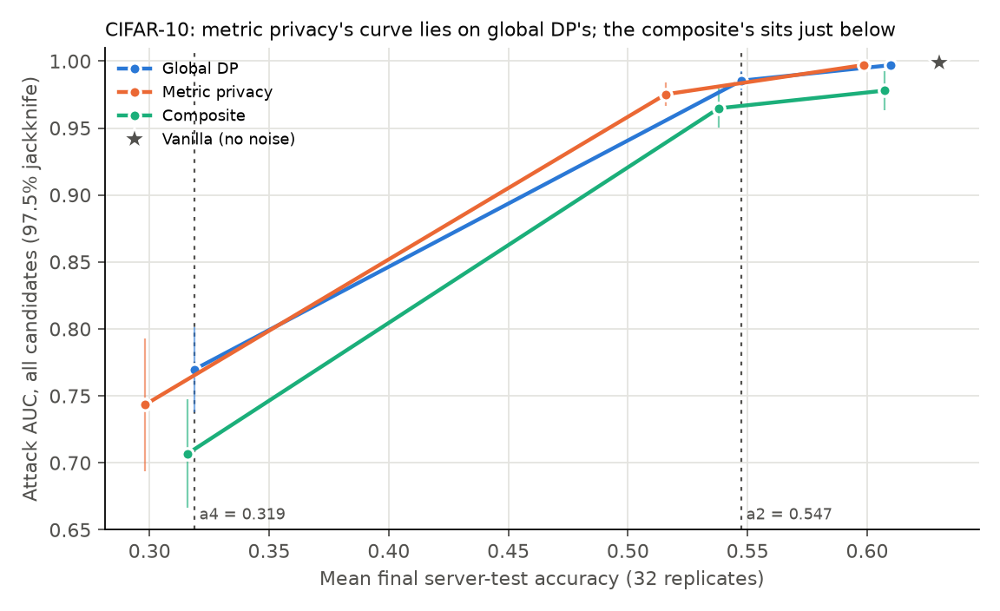
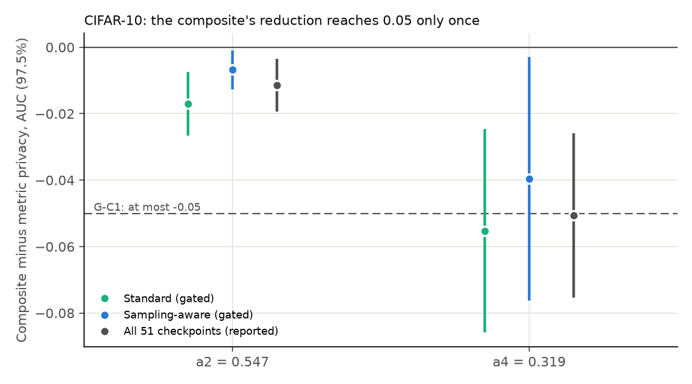

# P2 findings: CIFAR-10 replication of A-3 and D-4

Package P2 of `research/cia_roadmap_v3/ROADMAP.md` (direction F2). Design and gates in [STATE.md](STATE.md), runs, level
rule and analysis in [PROTOCOL.md](PROTOCOL.md) (fixed before any run). Numbers come from [analysis.json](analysis.json)
(`analyze.py --stage b`), [analysis_stage_a.json](analysis_stage_a.json) and [pilot_levels.json](pilot_levels.json);
figures from `make_figures.py`. Before any new number, the analysis code reproduced A1's published metric privacy minus
global DP at 0.740, -0.000 [-0.019, 0.018].

## Verdict

**G-P2a passed; G-P2b: A-3 replicates, D-4 does not** (ROADMAP Section 4: "the positive section is stated for EuroSAT
only, with CIFAR-10 as a bound; the owner reconsiders decision 1").

| Comparison (all candidates, 97.5% pair jackknife) | `a2` = 0.547 | `a4` = 0.319 | Outcome |
|---|---|---|---|
| G-A1: metric privacy minus global DP | **-0.002 [-0.008, 0.005]**, equivalent | -0.004, not testable | **A-3 replicates** |
| G-C1, standard attacker: composite minus metric privacy | -0.017 [-0.027, -0.007], fail | **-0.055 [-0.086, -0.025]**, pass | **D-4 does not replicate** |
| G-C1, sampling-aware attacker | -0.007 [-0.013, -0.001], fail | -0.040 [-0.076, -0.003], fail | **D-4 does not replicate** |

G-C1 passes at a target only if the composite is at least 0.05 below metric privacy with the interval below 0.

## Claim 1: on CIFAR-10, metric privacy leaks like global DP at the same accuracy

At `a2` the two mechanisms differ by -0.002 [-0.008, 0.005] (top decile -0.006 [-0.029, 0.016]), well inside the
+-0.03 equivalence margin, as on EuroSAT (A1). At `a4` the comparison is not testable: global DP's noisiest level
(4x) is the curve's lowest point and defines `a4`, so the leave-one-pair-out curves do not reach it. The two-way
bootstrap there, [-0.041, 0.026] with 984 of 2,000 resamples bracketed, shows no difference either.

## Claim 2: the composite's privacy gain does not carry over to CIFAR-10

The composite (client subsampling at `q = 0.25` with logit adjustment, `tau = 1`) leaks less than metric privacy at both
targets, and every interval lies below 0. But the reduction reaches G-C1's 0.05 only once, at `a4` under the standard
attacker (-0.055). At `a2` it is -0.017. The sampling-aware attacker, which uses the target's sampling schedule, cuts it
to -0.007 at `a2` and -0.040 at `a4`. On EuroSAT, C1 measured -0.095 and -0.108 under the standard attacker.

## Results

M2's regime on CIFAR-10 (P0's `cifar10` profile): label-Dirichlet alpha 0.3, 48 slots, 32 candidates, 16 IN per
replicate, 16 always in, 32 active; 50 rounds, 5 local epochs, clipping 5, equal weights; `R = 32`, `design_seed = 2`,
1,024 trials per configuration. 320 stage-b runs (vanilla's first 8 are stage a), plus 26 pilot runs; every run passed
the every-client check. The replacement check after the first half kept every level.

### Stage a and the pilot

G-P2a: vanilla on replicates 0-7, all-candidate AUC 0.998 [0.995, 1.001] (threshold 0.65; EuroSAT's M2 vanilla 0.723),
mean final accuracy 0.633. Pilot (`design_seed = 3`, 2 runs per level), mean final accuracy: global DP 1x 0.616,
2x 0.554, 4x 0.326, 8x 0.100; metric privacy 1x 0.626, 2x 0.609, 4x 0.512, 8x 0.310; composite `r` 0.0001 0.614,
0.000773 0.606, 0.003092 0.537, 0.006184 0.327, 0.012368 0.100. Pilot targets 0.554 and 0.326; the safeguard passed.
Levels chosen: metric privacy 2x, 4x, 8x; composite `r` 0.000773, 0.003092, 0.006184 (no window qualified; the smallest
shortfall, 0.0004).

### Per level (gated attacker, all candidates)

| Configuration | Accuracy | Lowest client | AUC [97.5%] | Top decile | TPR@5% | TPR@1% |
|---|---|---|---|---|---|---|
| Vanilla | 0.630 | 0.440 | 0.999 [0.998, 1.000] | 1.000 | 0.996 | 0.971 |
| Global DP 1x | 0.610 | 0.401 | 0.997 [0.995, 0.999] | 0.996 | 0.988 | 0.945 |
| Global DP 2x | 0.547 | 0.355 | 0.985 [0.978, 0.993] | 0.976 | 0.939 | 0.791 |
| Global DP 4x | 0.319 | 0.160 | 0.770 [0.738, 0.801] | 0.692 | 0.209 | 0.076 |
| Metric privacy 2x | 0.598 | 0.384 | 0.997 [0.995, 1.000] | 0.999 | 0.990 | 0.959 |
| Metric privacy 4x | 0.516 | 0.319 | 0.975 [0.966, 0.984] | 0.952 | 0.885 | 0.629 |
| Metric privacy 8x | 0.298 | 0.137 | 0.743 [0.694, 0.793] | 0.680 | 0.238 | 0.061 |
| Composite `r` 0.000773 | 0.607 | 0.398 | 0.978 [0.964, 0.992] | 0.977 | 0.936 | 0.805 |
| Composite `r` 0.003092 | 0.538 | 0.346 | 0.965 [0.950, 0.979] | 0.964 | 0.836 | 0.592 |
| Composite `r` 0.006184 | 0.316 | 0.161 | 0.707 [0.666, 0.747] | 0.675 | 0.154 | 0.053 |

The composite's sampling-aware AUC per level: 0.981, 0.976, 0.722; on all 51 checkpoints (reported): 0.978, 0.971,
0.711. Realized sampling rate 0.250-0.253.

### Matched accuracy, reported alongside

| | `a2` = 0.547 | `a4` = 0.319 |
|---|---|---|
| Composite minus metric privacy, all 51 checkpoints | -0.011 [-0.019, -0.004] | -0.051 [-0.075, -0.026] |
| Composite minus metric privacy, top decile | -0.004 [-0.036, 0.029] | -0.027 [-0.111, 0.058] |
| Lowest-client accuracy: global DP / metric privacy / composite | 0.355 / 0.344 / 0.353 | 0.160 / 0.155 / 0.163 |

## Reading

- CIFAR-10 leaks far more than EuroSAT under this design: near-perfect inference at every useful accuracy (AUC
  0.97-0.99 at `a2`), and AUC 0.71-0.77 even at `a4`, where accuracy is half of vanilla's.
- A-3 replicates: metric privacy is no more private than global DP at matched accuracy, on a second dataset.
- D-4 does not: the composite helps a little (every interval below 0), but not by the 0.05 that defines "beats", and an
  attacker who uses the sampling schedule removes most of the gain. With P3's every-round result on EuroSAT
  (`results/cia_v3/robustness/FINDINGS.md`), the positive claim does not hold up.
- No mechanism buys fairness: the lowest client's accuracy at matched accuracy is the same for all three.

## Limits

- At `a2`, AUCs of 0.97-0.99 leave little room below; a fixed 0.05 reduction is demanding there. The rule was fixed
  before any run and is applied as written.
- A-3 rests on one testable target: `a4` is defined by global DP's lowest level, so the jackknife cannot be formed there.
- Absolute AUC depends on the design (16 of 32 candidates IN, 32 active) and on `R` (P3; ROADMAP decision 9). Every
  comparison here holds both fixed.
- Order deviation: this analysis ran before P3's interference check, which the roadmap puts first. The check found no
  IN-count effect distinguishable from 0 at a fixed active count, and the owner decided on no correction (decision 9).
- Runs used 2 or 4 parallel clients (PROTOCOL.md says 4). Parallelism changes scheduling, not trajectories.
- One design (alpha 0.3, layout 42) and one model.

## Cost

Compute server, GPUs shared with other jobs (ROADMAP decision 4), up to four workers. Summed run time 247.7 run-hours:
stage a 8.0, pilot 21.3, stage b 218.4. Failed tries (host-memory kills and out-of-memory errors when other jobs grew,
about 9.5 hours of a broken launcher on 2 November) kept nothing and are not counted. GPU occupancy is lower than summed
run time because several workers shared a GPU. The cap was about 290 GPU-h (decision 6).
