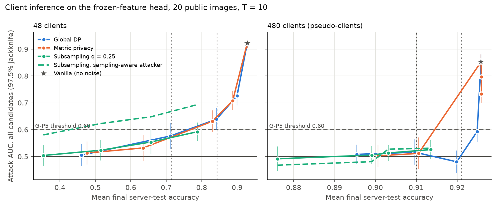

# P5 findings: client inference in the formal regime

Roadmap v3, package P5 (Agent F), 2026-10-30.
- **Protocol:** [PROTOCOL.md](PROTOCOL.md), fixed @ `45f3af54` before any run, with Amendment 1 (owner decision on
  [ESCALATION.md](ESCALATION.md)) @ `a8273d8a`, also before any run.
- **Numbers:** [analysis.json](analysis.json), from `python -m experiments.frozen_head.formal_cia analyze` on the 832
  run JSONs in `results/runs/`.
- **Tables:** `tables/configs.csv` and `tables/matched.csv`, from `make_figures.py`.
- **Reproduction first** ([reproduction.json](reproduction.json)):
  - five B4 Part D runs re-run with the modified code give identical accuracy and shadow losses within 1.8e-5
    (tolerance 1e-4);
  - B4's published AUC 0.638 [0.587, 0.689] is recovered to 3 decimals.

**Claim 1. At the real 48 clients, global DP at `mu = 2` is not protective by the roadmap's rule. With 480
pseudo-clients it is.**
- The calibrated attacker reaches **0.639 [0.598, 0.680]** at 48 clients, so the upper end is above 0.60.
- At 480 pseudo-clients it reaches **0.480 [0.438, 0.523]**.
- Both replicate B4's audit on fresh seeds: 0.638 at 48 clients, 0.547 at 480.

**Claim 2. In the formal regime, neither metric privacy nor subsampling protects better than global DP at matched
accuracy.**
- At 48 clients, metric privacy is **equivalent to global DP within ±0.03 at both targets**, so A-3 carries over.
- Subsampling shows **no detectable difference** from global DP under the standard attacker.
- It **leaks more** (+0.090 [0.040, 0.140] AUC) once the attacker knows the sampling schedule.
- So subsampling's full-network advantage (D-3, D-4) does not carry over here.

*Figure: the calibrated attacker's all-candidate AUC (97.5% pair-jackknife bars) against mean final accuracy, one
point per noise level. Dotted verticals mark the targets; the dashed line marks G-P5's 0.60. Subsampling is drawn on
its own levels only (deviation 1 below). Numbers are in the tables.*

## Gate: G-P5 (report)

> **G-P5 (report).**
> - Global DP at `mu = 2` with an AUC upper bound of at most 0.60: "protective regime confirmed".
> - The matched-accuracy differences between the three mechanisms are reported with the pair jackknife.

| Federation | Global DP `mu = 2`: AUC [97.5% jackknife] | Accuracy | Verdict |
|---|---|---|---|
| **48 clients (headline)** | **0.639 [0.598, 0.680]** | 0.842 | **not confirmed** |
| 480 pseudo-clients | 0.480 [0.438, 0.523] | 0.920 | protective regime confirmed |

- The 480-client federation protects pseudo-clients. Each real client is 10 of them, so its guarantee is `10 mu` by
  group privacy.
- The matched-accuracy differences are in the next section.

## Matched-accuracy differences (all candidates)

**Setup:**
- Targets are B4 Part D's global-DP accuracies at `mu` 2 and 1.
- "SA" means subsampling is scored by the sampling-aware attacker. The reference mechanism uses the standard attacker.
- Labels follow A1 (`outcome`) and decision 9 ("beats").
- **No comparison beats its reference.**

| `n` | Comparison | Target | Difference [97.5%] | Two-way [95%] | Label |
|---|---|---|---|---|---|
| 48 | metric privacy − global DP | 0.843 | +0.008 [-0.001, 0.017] | [-0.004, 0.019] | **equivalent** |
| 48 | metric privacy − global DP | 0.714 | -0.005 [-0.015, 0.004] | [-0.025, 0.012] | **equivalent** |
| 48 | subsampling − global DP | 0.714 | -0.007 [-0.050, 0.036] | [-0.052, 0.037] | no detectable difference |
| 48 | subsampling (SA) − global DP | 0.714 | +0.090 [0.040, 0.140] | [0.024, 0.160] | worse |
| 48 | subsampling − metric privacy | 0.714 | -0.001 [-0.042, 0.039] | [-0.041, 0.042] | no detectable difference |
| 48 | subsampling (SA) − metric privacy | 0.714 | +0.096 [0.052, 0.139] | [0.028, 0.165] | worse |
| 48 | subsampling (any) vs either | 0.843 | — | — | not testable (deviation 1) |
| 480 | metric privacy − global DP | 0.910 | -0.004 [-0.043, 0.035] | [-0.069, 0.060] | no detectable difference |
| 480 | metric privacy − global DP | 0.921 | +0.239 [-0.137, 0.615] | [0.105, 0.300] | worse or inconclusive (deviation 2) |
| 480 | subsampling − global DP | 0.910 | +0.007 [-0.042, 0.055] | [-0.062, 0.078] | no detectable difference |
| 480 | subsampling (SA) − global DP | 0.910 | +0.015 [-0.042, 0.071] | [-0.057, 0.089] | no detectable difference |
| 480 | subsampling − metric privacy | 0.910 | +0.010 [-0.042, 0.063] | [-0.064, 0.083] | no detectable difference |
| 480 | subsampling (SA) − metric privacy | 0.910 | +0.019 [-0.051, 0.088] | [-0.058, 0.097] | no detectable difference |
| 480 | subsampling (any) vs either | 0.921 | — | — | not testable (deviation 1) |

- The top-5 subset is in `tables/matched.csv`. As in B4, it is reported but not read, because it cannot be resolved
  at `R = 32`.
- **Measured precision (standard v3 item 2):**
  - metric privacy against global DP at 48 clients: half-widths 0.009-0.010;
  - every subsampling comparison: half-widths 0.04-0.07.

## Deviations from the written analysis (stated, not hidden)

1. **Vanilla is not subsampling's noise-free end.**
   - **What the protocol did:** Section 7 put vanilla at the noise-free end of every curve. That is right for global
     DP and metric privacy (`z -> 0`). Subsampling's limit is subsampling without noise, which was not run.
   - **What it produced:** the pre-registered computation gives subsampling "worse" at the upper targets:
     - +0.081 [0.049, 0.112] against global DP at 0.843;
     - +0.218 [0.172, 0.264] at 0.921.

     These values come from a straight line between subsampling's highest level (accuracy 0.788 and 0.914) and
     vanilla, so they are not a measurement of subsampling.
   - **Corrected reading (post hoc, not pre-registered):** without vanilla, subsampling's accuracy range is
     0.353-0.788 at 48 clients and 0.876-0.914 at 480. The upper targets are therefore **not testable** for
     subsampling, and standard v3 item 5 counts that as no pass.
   - **What is unchanged:** the lower-target comparisons do not involve vanilla.
   - The figure follows the corrected reading. `analysis.json` keeps the pre-registered numbers.
2. **Metric privacy reaches vanilla accuracy at 480 clients.**
   - At `mu` 2 and 4 its accuracy equals vanilla's (0.926), so its curve is vertical there.
   - The 0.921 comparison then depends on how resamples order three tied points. Its gate interval [-0.137, 0.615] is
     not interpretable.
   - What it does show: at the accuracy ceiling, metric privacy's AUC runs from 0.734 to 0.852, against 0.593 for
     global DP at `mu = 4` (accuracy 0.925).

## Why metric privacy tracks global DP here

**The distance it divides by sits near 1 at 48 clients.**

| `n` | Level | Median `d_t` (range) | Metric-privacy noise / global DP's (median) |
|---|---|---|---|
| 48 | `mu` 0.5 / 1 / 2 / 4 | 1.10 / 0.79 / 0.92 / 0.81 (0.59-1.69) | 0.91 / 1.26 / 1.09 / 1.24 |
| 480 | `mu` 0.5 / 1 | 1.33 / 1.32 (0.53-2.51) | 0.75 / 0.76 |
| 480 | `mu` 2 / 4 | 5.90 / 5.91 (1.60-11.69) | 0.17 / 0.17 |

- At 48 clients metric privacy is global DP with a slightly noisier, data-dependent scale. Its equivalence at
  matched accuracy is therefore partly mechanical.
- At 480 clients and `mu` >= 2, B4's selected hyperparameters (clip 0.93 against 0.33 at `mu` <= 1) let the
  pseudo-clients' local models drift apart. Metric privacy then adds about 6 times less noise and leaks like vanilla.
  This is the paper's calibration buying accuracy with leakage, now with no guarantee at all.

## Subsampling at a matched formal guarantee (descriptive)

Paired AUC difference, subsampling minus global DP at the same formal `mu` (dominating `mu` at `delta_floor` 1e-10),
97.5% pair jackknife:

| `n` | `mu` | Standard attacker | Sampling-aware attacker | Accuracy difference |
|---|---|---|---|---|
| 48 | 0.5 | -0.001 [-0.024, 0.022] | +0.075 [0.029, 0.122] | -10.7 pp |
| 48 | 1 | -0.053 [-0.094, -0.012] | +0.046 [-0.004, 0.097] | -19.7 pp |
| 48 | 2 | -0.085 [-0.130, -0.040] | +0.009 [-0.045, 0.063] | -18.5 pp |
| 48 | 4 | -0.134 [-0.171, -0.097] | -0.033 [-0.076, 0.010] | -11.2 pp |
| 480 | 0.5 | -0.016 [-0.068, 0.035] | -0.040 [-0.082, 0.002] | -1.9 pp |
| 480 | 1 | -0.011 [-0.055, 0.034] | -0.035 [-0.079, 0.009] | -1.1 pp |
| 480 | 2 | +0.033 [-0.003, 0.069] | +0.047 [0.007, 0.087] | -1.7 pp |
| 480 | 4 | -0.068 [-0.103, -0.032] | -0.062 [-0.105, -0.019] | -1.1 pp |

**At 48 clients:**
- At equal guarantee, subsampling lowers the standard attacker's AUC only by losing 11-20 pp of accuracy. With 8
  expected participants per round, it puts 1.4-2.6 times more noise on each released average (`z_q / (q z)` at
  `mu` 0.5-4).
- Once the schedule is known, the reduction is gone.

**At 480 clients** there is no consistent pattern.

**Sampling-aware attacker:**
- Realized IN sampling rates are 0.253 at 48 clients and 0.250 at 480.
- Knowing the schedule raises the AUC by 0.08-0.10 at 48 clients, more than on the full network (0.00-0.07, v3
  re-analysis). Every round is scored here (`T = 10`), and each sampled round is one of only about 8 contributions.

## Fairness alongside (standard v3 item 6; not gated)

Lowest client local-test accuracy (mean over replicates), interpolated at the targets:
- **48 clients, 0.714:** global DP 0.466, metric privacy 0.477, subsampling 0.477.
- **48 clients, 0.843:** global DP 0.653, metric privacy 0.652. Subsampling is not testable there (deviation 1).
- **480 clients:** the minimum is 0 for every mechanism, because many local test sets hold 1-3 records. The 10th
  percentile at 0.910 is 0.755-0.757 for all three.

No mechanism trades fairness differently at matched accuracy in this regime. That differs from the full network,
where subsampling cost 4-9 pp (`HANDOFF_AUDIT.md` C8).

## Validity and hypothesis

**Validity:**
- No configuration's jackknife lower end exceeds its formal AUC bound (`bound_violated` false throughout).
- Leakage without noise is high: vanilla AUC 0.921 at 48 clients and 0.852 at 480. The attacker is strong where
  there is leakage.

**Hypothesis (STATE.md):**
- **Partly supported.** "Metric privacy gives no extra protection at matched accuracy": supported.
- **Not supported:** "global DP and subsampled DP both keep AUC near 0.5" fails at the real 48 clients:
  - global DP is at 0.576-0.639 for `mu` 1-2;
  - subsampling at its accuracy-matched point (0.714) is 0.571, and 0.668 under the sampling-aware attacker.
- **Held:** the prediction that the regime is protective only at 480 pseudo-clients.

## Limits

- One extractor, one dataset (EuroSAT), one layout (42) and one public subset of 20 images.
- `T = 10`.
- Hyperparameters were taken from B4's global-DP tuning for every mechanism. Tuning per mechanism could help
  subsampling's accuracy.
- The 480-client rows are a pseudo-client split.
- The features are the owner PC's cache (Amendment 1).
- The simulator is in-process NumPy, not the Flower message path, as in B4.

## Cost

- 832 runs, 0.32 CPU-hours of recorded run time, 6 single-thread workers on the owner PC, 2026-10-30.
- Analysis about 2 minutes.
- Feature extraction once (not timed). No GPU.
