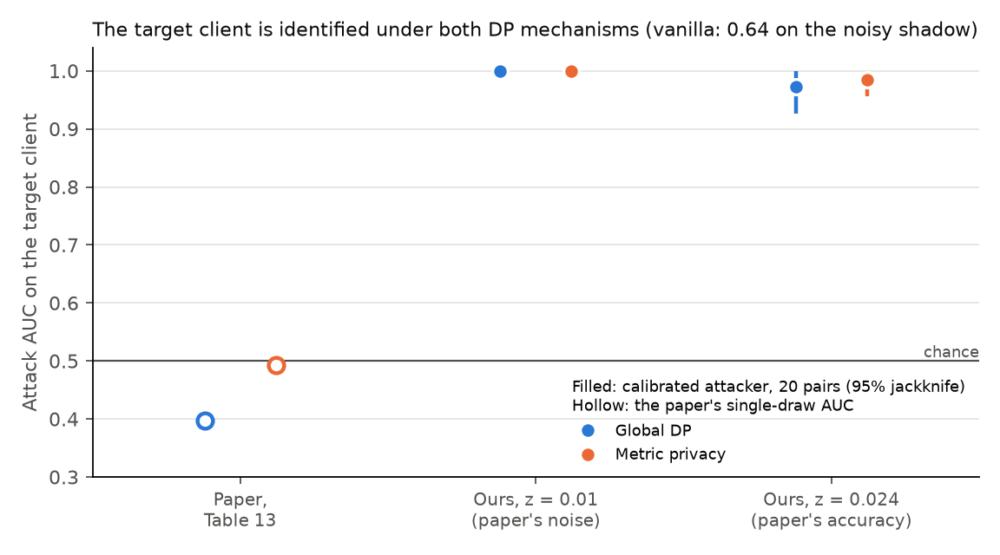
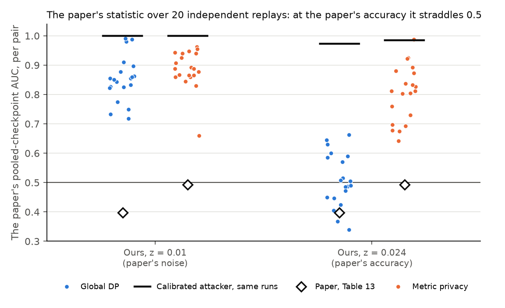

# P1 findings: the paper's 3-client setting under measurement standard v3

Package P1 of `research/cia_roadmap_v3/ROADMAP.md` (direction F3). Design and gate in [STATE.md](STATE.md), runs and
analysis rules in [PROTOCOL.md](PROTOCOL.md) (fixed before any run). Numbers come from [analysis.json](analysis.json)
(`analyze.py --main vanilla gdp-z0.01 mp-z0.01 --extension gdp-z0.024 mp-z0.024`); figures from `make_figures.py`.
Before any new number, the analysis code reproduced M2's published vanilla AUC, 0.723.

## Verdict

**G-P1: "the published protection claim fails in its own setting"**, at the paper's noise (`z = 0.01`) and again at
the paper's accuracy (`z = 0.024`, the declared extension). At the paper's accuracy the second clause also holds:
**"Table 13 is a single draw from a wide distribution."**

| Configuration | IN accuracy | Calibrated attacker, AUC [95%] | Paper's statistic over 20 pairs: median (p05-p95) | Pairs below 0.5 |
|---|---|---|---|---|
| Global DP, `z = 0.01` | 0.947 | **1.000 [1.000, 1.000]** | 0.853 (0.732-0.988) | 0 |
| Metric privacy, `z = 0.01` | 0.957 | **1.000 [1.000, 1.000]** | 0.887 (0.822-0.955) | 0 |
| Global DP, `z = 0.024` | 0.672 | **0.973 [0.927, 1.018]** | **0.497 (0.366-0.646)** | **10** |
| Metric privacy, `z = 0.024` | 0.915 | **0.985 [0.956, 1.014]** | 0.812 (0.673-0.928) | 0 |
| Vanilla | 0.970 | 0.637 [0.474, 0.801] | 0.749 (0.213-0.913) | 3 |
| *Paper, Table 13* | *0.637 (global DP)* | - | *global DP 0.397, metric privacy 0.493 (one draw each)* | - |

The jackknife intervals are symmetric and can pass 1; AUC itself cannot.

## Claim 1: in the paper's own setting, both DP mechanisms let an attacker identify the target client

The paper reads AUCs of 0.397 (global DP) and 0.493 (metric privacy) as protection. Replayed 20 times with independent
private randomness in every world, the same setting gives a calibrated attacker an AUC of 1.000 under both mechanisms at
the paper's noise, and 0.973 and 0.985 at the noise that brings global DP down to the paper's accuracy. Every lower
bound is above 0.5. On the target's actual records (the clean shadow sample) the IN model's mean final loss is 0.008
to 0.043 against 1.08 to 1.65 in the OUT world, for each of the three mechanisms at `z = 0.01`: the target's data is
memorized, and noise at `z = 0.01` does not prevent it.

## Claim 2: the paper's number is one draw, and an AUC below 0.5 is not protection

The paper's statistic pools 20 dependent checkpoint scores from one IN and one OUT trajectory. At the paper's accuracy
it ranges from 0.366 to 0.646 over the 20 pairs (median 0.497; 10 pairs below 0.5) for global DP, so Table 13's 0.397
is an ordinary draw. On the same runs the calibrated attacker scores 0.973. The difference is that the calibrated
attacker learns from reference trajectories which direction separates the worlds, while the paper's statistic fixes it
(lower loss means IN). Where the direction flips, an uncalibrated statistic falls below 0.5 while the worlds stay
separable. On global DP at `z = 0.024`, the IN world's final loss on the noisy shadow is higher than the OUT world's in
19 of 20 pairs (mean 12.6 against 4.3), although on the clean shadow it is lower (2.25 against 3.59). The final-round
loss threshold therefore scores 0.113 [-0.019, 0.244]: near-perfect separation with the sign reversed.

## Results

Setting (the paper's Section 7.4.2): Alzheimer MRI, 3 clients by Table 9 (target client 3), FedAvg weighted by
examples, 20 rounds, 5 local epochs, clipping 5, noise std `z C / n_t` (divided by the round's maximum client distance
for metric privacy), shadow sample 10% of the target's records with 20% pixel noise. One pair = an IN world (3
clients) and an OUT world (target removed); each world draws its own client and noise seeds. 200 runs (5 configurations
x 20 pairs x 2 worlds) plus 20 pilot runs; every run passed the every-client check.

### Reported attackers and accuracy

| Configuration | Calibrated, clean shadow | Final-round threshold | TPR at 5% FPR | Accuracy IN / OUT | Lowest client IN (range) |
|---|---|---|---|---|---|
| Vanilla | 1.000 [1.000, 1.000] | 0.823 [0.649, 0.996] | 0.25 | 0.970 / 0.917 | 0.958 (0.936-0.973) |
| Global DP, `z = 0.01` | 1.000 [1.000, 1.000] | 0.970 [0.921, 1.019] | 1.00 | 0.947 / 0.862 | 0.937 (0.905-0.955) |
| Metric privacy, `z = 0.01` | 1.000 [1.000, 1.000] | 1.000 [1.000, 1.000] | 1.00 | 0.957 / 0.911 | 0.946 (0.926-0.960) |
| Global DP, `z = 0.024` | 0.985 [0.958, 1.012] | 0.113 [-0.019, 0.244] | 0.85 | 0.672 / 0.617 | 0.566 (0.318-0.698) |
| Metric privacy, `z = 0.024` | 1.000 [1.000, 1.000] | 0.907 [0.824, 0.991] | 0.95 | 0.915 / 0.773 | 0.897 (0.828-0.944) |

Accuracy is Table 13's: aggregated client-test accuracy averaged over rounds 16-20. TPR at 5% FPR rests on 20 OUT
trials (one false positive), so it is descriptive only.

### The extension's noise level

The paper's accuracy is not reproduced at its own noise (0.947 against 0.637), so the declared extension runs both
mechanisms at `z_acc`. Accuracy pilot (global DP, two IN runs per level): `z` 0.0075 0.961, 0.015 0.893, 0.03 0.501,
0.06 0.447, 0.12 0.501. Log-linear interpolation between 0.015 and 0.03 gave `z_acc = 0.024` (recorded in STATE.md
before any extension run). The extension measured 0.672, not 0.637: accuracy falls from 0.89 to 0.50 within one
doubling of `z`, so interpolation is coarse there. At the same `z`, metric privacy keeps 0.915, because its noise is
divided by the round's maximum client distance.

## Reading

- The paper's protection claim does not survive replication in its own setting: at its noise and at its accuracy, the
  target client's participation is identifiable in nearly every replay under both mechanisms.
- Its AUCs below 0.5 are consistent with chance variation of a single-pair statistic, and with a fixed-direction score
  whose direction flips. Neither is evidence of protection.
- Vanilla scores lower than the DP mechanisms on the noisy shadow (0.637) only because its noisy-shadow losses vary
  widely (final loss IN 9.4 +/- 15.5); on the clean shadow it scores 1.000 like the others. The ordering across
  mechanisms on the noisy shadow is therefore not a leakage ranking.

## Limits

- One dataset, one partition (Table 9) and one target client, as in the paper; the claims are about that setting.
- The paper's own noisy-shadow attacker is the reported instrument; its 20% pixel noise is what makes vanilla's scores
  erratic, and we did not vary it.
- The extension's accuracy is 0.672, above the paper's 0.637; the global DP accuracy curve is too steep at this point
  to match it more closely with the protocol's one interpolation.
- Why the noisy-shadow loss is higher in the IN world for global DP at `z = 0.024` (and not for metric privacy, where
  it is lower in 18 of 20 pairs) is not diagnosed.
- With 20 pairs, the 95% pair jackknife is the interval; intervals at AUC 1.000 are degenerate (every pair separates).

## Cost

Compute server, one worker, GPUs shared with other users' jobs (ROADMAP decision 4). Summed training time 14.0
run-hours (vanilla 2.20, global DP `z = 0.01` 2.54, metric privacy `z = 0.01` 2.63, global DP `z = 0.024` 2.53,
metric privacy `z = 0.024` 2.90, pilot 1.21) plus about 14 s of evaluation per run: about 15 GPU-h against the 40 GPU-h
cap. Failed attempts (out of memory when other users' jobs grew, and Ray's host-memory limit) stopped in round 1 and
kept nothing; they are not counted. Wall-clock time was longer than compute: the extension waited 18 h on a queueing
bug (STATE.md, 2026-11-01 15:59) and about 6 h on GPU memory.
