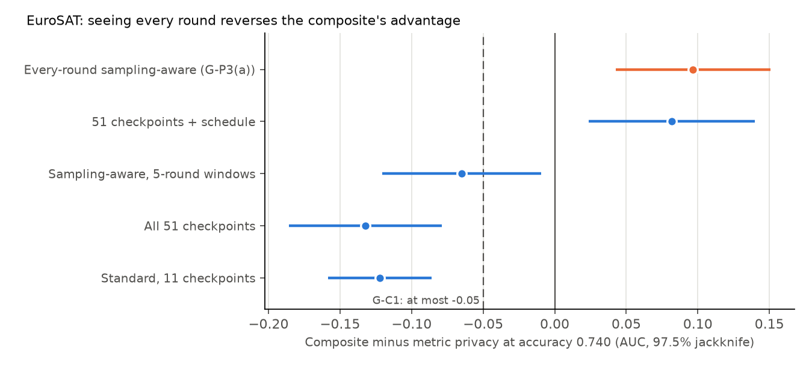
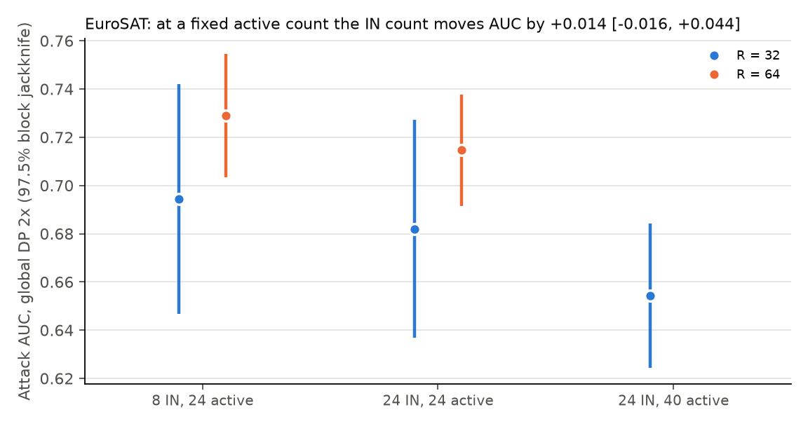

# P3 findings: every-round attacker and IN-count interference check

Package P3 of `research/cia_roadmap_v3/ROADMAP.md` (direction F4), with ROADMAP decisions 7-9. Design and gate in
[STATE.md](STATE.md), runs and analysis in [PROTOCOL.md](PROTOCOL.md) (Sections 1-4 fixed before any run, Sections 5 and
6 before their runs). Numbers come from [analysis.json](analysis.json), [analysis_follow_up.json](analysis_follow_up.json)
and [analysis_follow_up_r64.json](analysis_follow_up_r64.json); figures from `make_figures.py`. Before any new number,
every analysis reproduced C1's published composite minus metric privacy at 0.740, -0.095 [-0.137, -0.053].

## Verdict

| Gate | Result | Outcome |
|---|---|---|
| G-P3(a): composite minus metric privacy, every-round sampling-aware attacker | 0.740: **+0.097 [0.042, 0.151]**; 0.660: not testable | **fail** |
| G-P3(b): AUC(8 IN) - AUC(24 IN) | **+0.040 [0.009, 0.072]** (24 against 40 active) | **fail**, escalated |
| Follow-up: the IN count at a fixed 24 active, `R = 64` | **+0.014 [-0.016, 0.044]** | inconclusive; no correction (decision 9) |

The owner put the every-round attacker in scope (decision 8), so D-4 does not hold on EuroSAT against it.

## Claim 1: an attacker who sees every round finds the composite leakier than metric privacy

At accuracy 0.740, the composite looks clearly more private than metric privacy to the standard attacker (-0.122) and
narrowly so to the 5-round sampling-aware attacker (-0.065). An attacker who knows the rounds in which the target is
sampled, and looks at every round, reverses that: +0.097 [0.042, 0.151]. In a round where the target trains, the loss
on its records drops; the schedule statistic alone scores the composite 0.807 and 0.779 at its two levels, against
metric privacy's 0.706 and 0.679 under the standard attacker. Subsampling hides a client among rounds, but the rounds
it trains in give it away.

## Claim 2: absolute AUC depends on the design, but the IN count itself barely matters

With 16 slots always taking part, 8 IN means 24 active clients and 24 IN means 40, and G-P3(b)'s gap of +0.040
confounds the two. Holding the active count at 24 leaves +0.014 [-0.016, 0.044] at `R = 64` (+0.012 [-0.025, 0.050]
at `R = 32`), not distinguishable from 0. Holding the IN count at 24, going from 24 to 40 active clients moves AUC by
+0.028 [-0.008, 0.064]. By point estimates, most of the gap is the active count. AUC also rises with `R`, by about 0.035
from 32 to 64 replicates, because the calibrated attacker gets twice the references. Absolute AUC is therefore a
property of the design and of `R`; comparisons that hold both fixed, as every matched-accuracy comparison does, are not
affected (decision 9).

## Results

EuroSAT in M2's regime: 48 slots, 32 candidates, 50 rounds, 5 local epochs, clipping 5, equal weights, `design_seed = 2`.
288 runs: the six configurations of PROTOCOL.md Section 1 (192), the fixed-active configuration (32), and replicates
32-63 of the two 24-active configurations (64). Every run passed the every-client check.

### The composite and metric privacy (`R = 32`, every-round scoring)

| Configuration | Accuracy | Standard AUC [97.5%] | 5-round sampling-aware | Every-round | Schedule statistic alone |
|---|---|---|---|---|---|
| Composite `r` 0.000773 | 0.776 | 0.582 [0.541, 0.624] | 0.630 | 0.820 | 0.807 |
| Composite `r` 0.003092 | 0.724 | 0.578 [0.531, 0.625] | 0.640 | 0.788 | 0.779 |
| Metric privacy 1x | 0.752 | 0.706 [0.652, 0.760] | | | |
| Metric privacy 2x | 0.678 | 0.679 [0.625, 0.732] | | | |

Composite minus metric privacy at 0.740 (pair jackknife at 97.5%; two-way bootstrap):

| Composite attacker | Difference | Two-way |
|---|---|---|
| Standard, 11 checkpoints | -0.122 [-0.158, -0.086] | [-0.187, -0.062] |
| All 51 checkpoints | -0.132 [-0.186, -0.079] | [-0.197, -0.069] |
| Sampling-aware, 5-round windows | -0.065 [-0.120, -0.009] | [-0.128, 0.003] |
| 51 checkpoints plus the schedule statistic | +0.082 [0.024, 0.140] | [0.020, 0.147] |
| **Every-round sampling-aware (G-P3(a))** | **+0.097 [0.042, 0.151]** | [0.035, 0.161] |

0.660 is not testable for any of them (the levels stop at 0.724 and 0.678). Lowest-client accuracy at 0.740: composite
0.452, metric privacy 0.497. The composite runs repeat C1's seeds; their standard AUCs (0.582, 0.578) are close to C1's
(0.592, 0.614).

### IN-count configurations (global DP 2x, block jackknife at 97.5%)

| Configuration | `R` | AUC | Top decile | Accuracy | Lowest client |
|---|---|---|---|---|---|
| 8 IN, 16 always in (24 active) | 32 | 0.694 [0.647, 0.742] | 0.807 | 0.731 | 0.473 |
| 24 IN, 16 always in (40 active) | 32 | 0.654 [0.624, 0.684] | 0.802 | 0.749 | 0.527 |
| 24 IN, none always in (24 active) | 32 | 0.682 [0.637, 0.727] | 0.796 | 0.761 | 0.539 |
| 8 IN, 16 always in (24 active) | 64 | 0.729 [0.703, 0.754] | 0.831 | 0.732 | 0.491 |
| 24 IN, none always in (24 active) | 64 | 0.715 [0.692, 0.738] | 0.786 | 0.761 | 0.540 |

For reference, M2's 16-IN design (32 active, `R = 32`) gave 0.702 [0.643, 0.761] at accuracy 0.740.

## Reading

- Under an attacker who knows the target's sampling schedule (in scope, decision 8), client subsampling does not
  protect: the composite leaks more than metric privacy at the same accuracy. The 5-round attacker of measurement
  standard v3 under-states this, because it averages the schedule over windows.
- D-4 therefore holds on EuroSAT only against attackers without the schedule. With P2 (D-4 does not replicate on
  CIFAR-10), the composite's advantage is not a robust result.
- The randomized-inclusion design measures absolute AUC that depends on the active count and on `R`; it is a valid
  instrument for comparisons within one design and one `R`, which is how every v2 and v3 gate uses it.

## Limits

- The every-round attacker scores IN trials with the target's real schedule and OUT trials with a simulated i.i.d.
  schedule (`reanalyze.simulated_schedules`). That is the threat model decision 8 accepts; an attacker without the
  schedule is described by the standard and 5-round rows.
- G-P3(a) rests on one target: the levels were the roadmap's (bracketing 0.740), so 0.660 is not testable.
- The IN-count follow-up holds the active count at 24, not 32: EuroSAT has only 16 non-candidate slots (decision 7). Its
  interval still allows effects up to 0.044.
- EuroSAT only.

## Cost

Compute server, GPUs shared with other jobs (ROADMAP decision 4). Summed run time 75.6 run-hours: the six configurations
52.8, the fixed-active follow-up 7.6, the `R = 64` extension 15.2. The original design ran 21:43 on 6 November to
16:11 on 7 November on both GPUs, about 37 GPU-h of occupancy at most against the 35 GPU-h cap (escalation 43.75); the
follow-ups were added by decisions 7 and 8. 51 tries failed with out-of-memory errors when Agent P ran five workers on
the two GPUs (7 November, 14:00-16:00); they kept nothing and are not counted.
